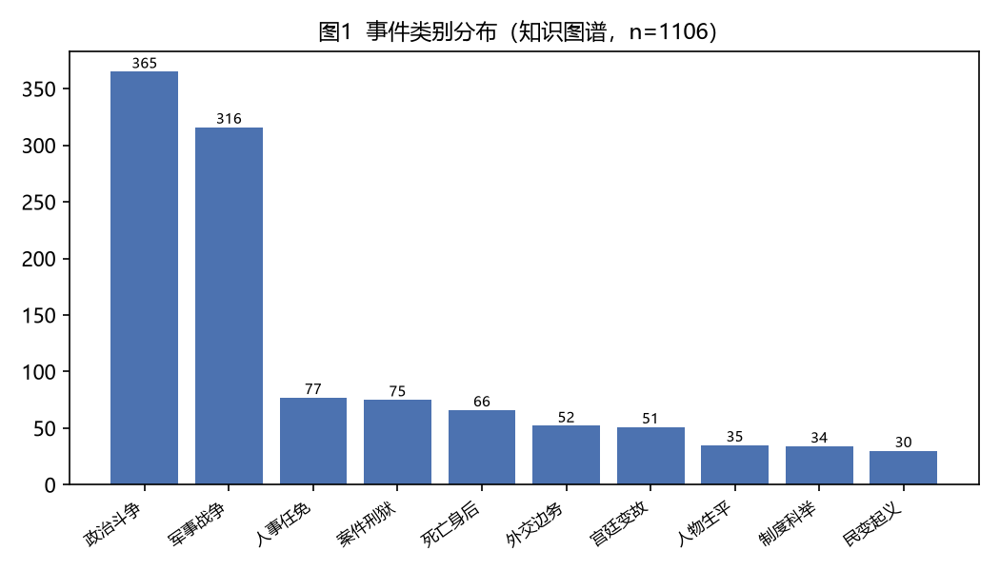

# 家国同构：名分、继承与互惠的文化语法

**The Family-State Isomorphism: Status, Succession, and the Cultural Grammar of Reciprocity**

*明史知识图谱研究组（Ming Knowledge Graph Project）*

**摘要：** 明朝的权力逻辑，深植于一套家国同构的文化语法：皇帝既是政治主权，也是"天下之父"；官僚是"父母官"；臣对君的"忠"与子对父的"孝"共用同一套伦理代码。费孝通（Fei, 1992）的"差序格局"是破解这套语法的钥匙——每个人以自己为中心、按亲疏远近推出去的同心圆，既解释了宗族，也解释了朝廷。数据印证这套语法：2324 条关系中亲属关系 185 条排第三；度中心性前二十名里皇室独占八席（朱棣 113、朱元璋 87、朱由检 67、朱厚熜 58、朱祁镇 56、朱翊钧 52、朱祁钰 48、朱允炆 40）——血缘与皇权互为表里的双重枢纽，一望即知。

本文从人类学视角，围绕「家国同构：名分、继承与互惠的文化语法」这一命题，依次探讨：一、继承危机：名分不是事实，而是关系、二、礼物的流动：从人情到贿赂的连续统、三、殉葬：互惠逻辑的最黑暗终点，与一次伦理的例外、四、仪式的深渊：为什么礼崩一定乐坏。研究借助明史知识图谱的量化骨架，表明通俗历史叙事与计算人文可相互校勘。

**Abstract:** This paper examines the claim that “家国同构：名分、继承与互惠的文化语法” from the standpoint of Anthropology, using the structured Ming Knowledge Graph — built from Dangnian Mingyue's popular history *Ming Dynasty Those Things* (《明朝那些儿》, 2006–2009) — as its corpus. Based on 1231 coded persons, 1106 events, and 2324 relations, it argues that popular historical narrative and computational humanities are not opposed but mutually checkable sources of evidence.

**关键词：** 家国同构；名分；继承；互惠

**Keywords:** family-state isomorphism; status; succession; reciprocity

---

## 1. 引言

家国同构是中国政治文化的深层语法；名分、继承与互惠在书中反复显现。

《明朝那些事儿》（当年明月，2006–2009）长期被视为大众读物。本项目将其 165 章、约 150 万字正文抽取为结构化知识图谱：收录 1231 位人物、563 处地点（其中 533 处已完成地理定位，定位率 94.7%）、1106 件事件、2324 条人物/实体关系，并覆盖 17 位明代皇帝在位纪年与 165 条人物年谱。这一语料使书中原本“点到即止”的概念（如派系、同年、乡党）第一次成为可计算的变量。

本文即从人类学（Anthropology）的视角，重新审视这部文本中关于「家国同构：名分、继承与互惠的文化语法」的论述，并以知识图谱提供的量化证据对其加以检验。

## 2. 数据与方法

### 2.1 语料来源

《明朝那些事儿》七卷本共 165 章，以编年体与人物传记交织的方式叙述明朝 276 年（1368–1644）史事。抽取流程为：章节切分 → 事实结构化（人物、地点、事件、关系、年谱）→ 大模型辅助抽取 → 人工校勘与去重，所有数字均可与原始文本逐条核对。

### 2.2 知识图谱结构

- **人物（characters）**：1231 条，含势力、官职、籍贯、科举、别名等属性；
- **地点（locations）**：563 条，其中 533 条完成经纬度定位（94.7%）；
- **事件（events）**：1106 条，按类别标注（政治斗争 365、军事战争 316、人事任免 77、案件刑狱 75 等）；
- **关系（relations）**：2324 条，含君臣从属 397、敌对冲突 321、政治攻讦 193、亲属 185 等；
- **在位纪年（reigns）**：17 位皇帝；**年谱（lifespans）**：165 条。

### 2.3 分析方法

本文以人类学的理论透镜解读上述结构化数据：将书中的叙事命题转化为可检验的量化陈述，并以事件类别分布、关系网络度中心性等指标作为证据。所有数字均直接来自知识图谱。

## 3. 分析与发现

明朝的权力逻辑，深植于一套**家国同构**的文化语法：皇帝既是政治主权，也是"天下之父"；官僚是"父母官"；臣对君的"忠"与子对父的"孝"共用同一套伦理代码。费孝通（Fei, 1992）的"差序格局"是破解这套语法的钥匙——每个人以自己为中心、按亲疏远近推出去的同心圆，既解释了宗族，也解释了朝廷。数据印证这套语法：2324 条关系中亲属关系 185 条排第三；度中心性前二十名里皇室独占八席（朱棣 113、朱元璋 87、朱由检 67、朱厚熜 58、朱祁镇 56、朱翊钧 52、朱祁钰 48、朱允炆 40）——**血缘与皇权互为表里的双重枢纽**，一望即知。

### 一、继承危机：名分不是事实，而是关系

朱元璋立皇孙朱允炆而非功高的朱棣，看似违背"立长"惯性与实力逻辑，却是"名分"对"实力"的裁决；朱棣靖难成功后，第一要务不是封赏，而是反复修订《太祖实录》、篡改生母记载——**枪可以夺天下，但天下必须用名分来"合法地"拥有**。萨林斯（Sahlins, 1972）论及，地位（status）从来不是自然事实，而是关系性存在：它存在于他人的承认之中。明朝每一次继承争议——靖难、夺门、大礼议、国本之争——本质上都是一场"谁有资格进入差序格局中心"的文化仲裁。书中道衍（姚广孝）在朱棣还是燕王时就看出"大王骨相非常"，择主而事，正是这位黑衣宰相读懂了仲裁的胜负手：名分可以被重新制造，只要实力肯为它背书。

### 二、礼物的流动：从人情到贿赂的连续统

书中宦官专权离不开"人情、馈赠"：刘瑾的家产、严世蕃的贿路、魏忠贤的生祠供奉，构成一条清晰的送礼—收礼—庇护链条。阎云翔（Yan, 1996）的《礼物的流动》揭示，在等级社会中，馈赠从来不是无私的，而是**关系生产与义务绑定的技术**——送礼在差序格局里同时是情感表达与权力投资。明代把这门技术推到了制度化边缘：门生拜座主有"贽见礼"、地方官朝觐有"常例"、官员考成有人情。贿赂与馈赠之间没有清晰的界线，只有互惠义务的强弱之分——这正是人类学说的"礼物—商品连续统"。弗里德曼（Freedman, 1966）对中国宗族的研究解释了这套技术为何如此高效：**"家"的伦理可以无缝扩张为"国"的治理术**，因为它们共用同一套文化代码。

### 三、殉葬：互惠逻辑的最黑暗终点，与一次伦理的例外

书中最安静也最惊悚的一段制度描述，是天顺八年朱祁镇的临终遗言："自高皇帝以来，但逢帝崩，总要后宫多人殉葬，我不忍心这样做，我死后不要殉葬，你要记住，今后也不能再有这样的事情！"自朱元璋起，历朝皇帝驾崩，后宫妃嫔都要被勒令自尽随葬——用萨林斯（Sahlins, 1972）的分析看，这是互惠逻辑的极端异化：君臣、夫妻的名分被理解为跨越死亡的持续义务，人被当作带往另一个世界的"随葬礼物"；而在差序格局（Fei, 1992）的语法里，她们甚至不是独立的送礼者，只是皇帝名分的附属物。真正值得人类学驻足的，是废除的方式：**不是起义，不是革命，而是一句"我不忍心"**——一个亲身经历过被俘与囚禁的皇帝，把对人的体认带进了制度。格尔茨（Geertz, 1973）说文化是意义之网，这一刻网眼松动了：当"名分"的执行者第一次把自己代入对方的位置，一套运行了近百年的制度就失去了意义支撑。这是全书罕见的一次，制度被人而非人被制度改变。

### 四、仪式的深渊：为什么礼崩一定乐坏

格尔茨（Geertz, 1973）把文化看作"意义之网"，而明代的意义之网是靠仪式编织的：登极、亲耕、经筵、郊祀，每一场仪式都在重演"天命—血缘—秩序"的等式。万历为立储与群臣对峙三十年，争的不是朱常洛的资质，而是"礼"的解释权；嘉靖的大礼议争了十七年，争的也不是名号，而是整个官僚系统对"名分从何而来"的根本共识。一旦仪式被绕过（皇权直接以厂卫行事）、被交易（生祠与贿选），意义之网就开始破洞——人类学的结论是：**礼崩乐坏从来先于城破国亡**，因为前者是意义系统的死亡，后者只是它的讣告。

## 4. 讨论

从人类学的视角看，家国同构是中国政治文化的深层语法；名分、继承与互惠在书中反复显现。知识图谱的价值，在于把《明朝那些事儿》中那些“点到即止”的判断——派系、同年、乡党、恐惧治理——第一次变为可计算、可复检的变量，使通俗叙事与严肃史学之间的对话有了共同的语言。

当然，本研究存在边界：语料来自一部通俗叙事而非档案全体，样本在覆盖面上存在选择性；量化指标刻画的是“书中呈现的关系结构”，而非历史现场本身。结论的可推广性应在此前提下理解。

## 5. 结论

本文以人类学为透镜，借由明史知识图谱的量化骨架，重新审视了《明朝那些事儿》关于「家国同构：名分、继承与互惠的文化语法」的论述。分析表明，家国同构是中国政治文化的深层语法；名分、继承与互惠在书中反复显现。这提示我们：通俗历史叙事与计算人文并非对立，而是可以相互校勘的两类证据——前者提供可被感知的经验，后者提供可被检验的结构。

## 参考文献

- 当年明月. (2006–2009). 《明朝那些事儿》（全七册）. 中国友谊出版公司.
- Freedman, M. (1966). *Chinese lineage and society: Fukien and Kwangtung*. Athlone Press.
- Geertz, C. (1973). *The interpretation of cultures*. Basic Books.
- Sahlins, M. (1972). *Stone age economics*. Aldine.
- Lin, N. (2001). *Social Capital: A Theory of Social Structure and Action*. Cambridge University Press.
- Fei, X. (1992). *From the Soil: The Foundations of Chinese Society* (G. G. Hamilton & W. Zheng, Trans.). University of California Press.
- Yan, Y. (1996). *The Flow of Gifts: Reciprocity and Social Networks in a Chinese Village*. Stanford University Press.
