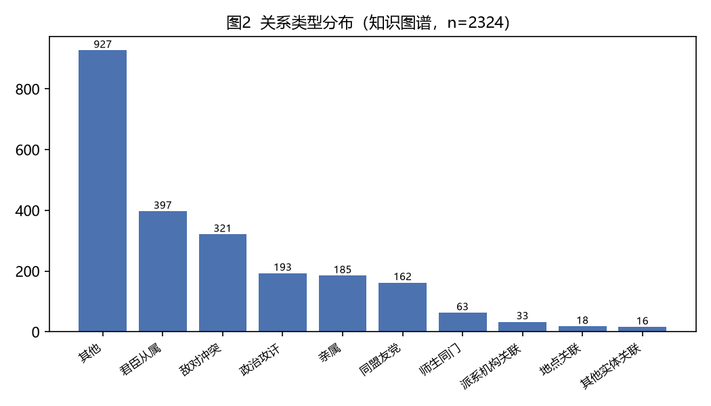

# 笔墨的突围：徐渭、唐寅与才子的命运

**The Breakthrough of Ink: Xu Wei, Tang Yin, and the Fate of Talents**

*明史知识图谱研究组（Ming Knowledge Graph Project）*

**摘要：** 在帝国的人才序列里，艺术家是没有位置的：科举不考绘画，功名不认诗人。但《明朝那些事儿》偏偏用最大的温柔，写了一串科举体系的"失败者"——徐渭连举人都考不中，唐寅被一场悬案毁掉前程，而他们恰恰是这个文明留给世界最重要的艺术遗产。艺术史的视角要问：明代的才华去哪儿了？答案藏在体制的缝隙里。

本文从艺术视角，围绕「笔墨的突围：徐渭、唐寅与才子的命运」这一命题，依次探讨：一、三大才子的序列：考不中的和被抹掉的、二、幕府里的败笔与光芒、三、崩溃：三次自杀与"医学界的奇迹"、四、灿烂的文化：为什么在最坏的年代。研究借助明史知识图谱的量化骨架，表明通俗历史叙事与计算人文可相互校勘。

**Abstract:** This paper examines the claim that “笔墨的突围：徐渭、唐寅与才子的命运” from the standpoint of Art History, using the structured Ming Knowledge Graph — built from Dangnian Mingyue's popular history *Ming Dynasty Those Things* (《明朝那些儿》, 2006–2009) — as its corpus. Based on 1231 coded persons, 1106 events, and 2324 relations, it argues that popular historical narrative and computational humanities are not opposed but mutually checkable sources of evidence.

**关键词：** 徐渭；唐寅；才子命运；笔墨突围

**Keywords:** Xu Wei; Tang Yin; fate of talents; ink breakthrough

---

## 1. 引言

徐渭、唐寅的命运，折射出明代才子在制度与个性之间的挣扎。

《明朝那些事儿》（当年明月，2006–2009）长期被视为大众读物。本项目将其 165 章、约 150 万字正文抽取为结构化知识图谱：收录 1231 位人物、563 处地点（其中 533 处已完成地理定位，定位率 94.7%）、1106 件事件、2324 条人物/实体关系，并覆盖 17 位明代皇帝在位纪年与 165 条人物年谱。这一语料使书中原本“点到即止”的概念（如派系、同年、乡党）第一次成为可计算的变量。

本文即从艺术（Art History）的视角，重新审视这部文本中关于「笔墨的突围：徐渭、唐寅与才子的命运」的论述，并以知识图谱提供的量化证据对其加以检验。

## 2. 数据与方法

### 2.1 语料来源

《明朝那些事儿》七卷本共 165 章，以编年体与人物传记交织的方式叙述明朝 276 年（1368–1644）史事。抽取流程为：章节切分 → 事实结构化（人物、地点、事件、关系、年谱）→ 大模型辅助抽取 → 人工校勘与去重，所有数字均可与原始文本逐条核对。

### 2.2 知识图谱结构

- **人物（characters）**：1231 条，含势力、官职、籍贯、科举、别名等属性；
- **地点（locations）**：563 条，其中 533 条完成经纬度定位（94.7%）；
- **事件（events）**：1106 条，按类别标注（政治斗争 365、军事战争 316、人事任免 77、案件刑狱 75 等）；
- **关系（relations）**：2324 条，含君臣从属 397、敌对冲突 321、政治攻讦 193、亲属 185 等；
- **在位纪年（reigns）**：17 位皇帝；**年谱（lifespans）**：165 条。

### 2.3 分析方法

本文以艺术的理论透镜解读上述结构化数据：将书中的叙事命题转化为可检验的量化陈述，并以事件类别分布、关系网络度中心性等指标作为证据。所有数字均直接来自知识图谱。

## 3. 分析与发现

在帝国的人才序列里，艺术家是没有位置的：科举不考绘画，功名不认诗人。但《明朝那些事儿》偏偏用最大的温柔，写了一串科举体系的"失败者"——徐渭连举人都考不中，唐寅被一场悬案毁掉前程，而他们恰恰是这个文明留给世界最重要的艺术遗产。艺术史的视角要问：明代的才华去哪儿了？答案藏在体制的缝隙里。

### 一、三大才子的序列：考不中的和被抹掉的

书中有一段耐人寻味的排序：明代三大才子，解缙、《永乐大典》总编，一个已经死了；杨慎，大礼议后被贬云南三十年；第三位"尚未出场"，叫做徐渭，"通常人们叫他徐文长"。作者还替杨慎辩护：他在云南"除了每天用心学习，天天向上，似乎也没有什么别的事干"——这句话里藏着一个规律：**三大才子有两位的成就，都是被政治放逐出来的**。而徐渭的起点更低：他"连个举人都考不中，虽然有名，也只是个有名的穷光蛋而已"。高居翰（Cahill, 1982）的晚明绘画史证明，正是在这个功名失意者聚集的时代，中国绘画迎来了最个人化、最激烈的表达高峰——体制不要的人，历史收下了。

### 二、幕府里的败笔与光芒

徐渭的故事前半段是一场双向的傲慢。总督胡宗宪主动来请他当幕僚，他用一口绍兴话回绝："从哪里来，回哪里去！谁让你来，你让他来！"——使者要靠翻译才听得懂；而"骄横不羁"的胡宗宪竟然让步了，说"我去找他"。后半段则是一场著名的妥协：为保住胡宗宪的位子以平定倭寇，徐渭提笔写了一篇"历史上著名的马屁文章"，言辞优美、荒诞不经，被很多人视为"人生中的败笔"。但作者给出了艺术史之外的判断："在这篇卑微下作的文章背后，隐藏着一种耀眼的光芒——即使卑躬屈膝，即使刻意逢迎，也绝不接受失败。"随后徐渭为胡宗宪制订了对徐海的"秘战法"，用间谍与反间把一方巨寇"无情地绞杀"。**艺术的才华在这里以参谋文书的形式兑现**——帝国只给它一种使用方式。

### 三、崩溃：三次自杀与"医学界的奇迹"

胡宗宪倒台时，徐渭"一句话也没说"，因为他知道自己完了。更深的痛苦是梦想的破灭："他虽然诗词书画样样精通，却并不想做一个文学家或艺术家，他希望获得功名，成就一番事业，这才是他真正的抱负。"精神崩溃后，书里冷静得近乎残忍地记录了他的三次自杀尝试：用斧头砍自己的头，用长钉钉入自己的脑袋，用锤子捶自己的肚子——"虽历经不懈的努力，他竟然还是没有死成……创造了医学界的奇迹"。柯律格（Clunas, 1997）在《Art in China》中提醒我们，中国艺术史上最震撼的作品，往往出自这种被体制与人世双重拒绝的人之手；徐渭后来的泼墨大写意，正是从那次"医学奇迹"里长出来的——**帝国拒绝了他的抱负，历史接收了他的笔墨**。

### 四、灿烂的文化：为什么在最坏的年代

书里有一段自我矛盾的感慨：嘉靖四十五年"是一个争议很大的时期，有人说是嘉靖中兴，也有人说是亡于嘉靖，但有一点是大家都不否认的——灿烂的文化"，随后历数《水浒传》《三国演义》《西游记》《金瓶梅》四大名著与杨慎、王世贞、徐渭的诗词书画。这个并列本身就是答案：**政治越收紧，被它漏出去的人越多，文化越灿烂**——杨慎在云南写词，唐寅在苏州画画（"别人笑我太疯癫，我笑他人看不穿"），徐渭在绍兴发疯。柯律格（Clunas, 1997）把中国艺术视为社会关系的产物，明代样本给出了最清晰的注脚：艺术不是盛世的奖品，而是失意者的出口。帝国的账本从不为艺术记账，而留给后世的，恰恰只有这些账本之外的痕迹。

## 4. 讨论

从艺术的视角看，徐渭、唐寅的命运，折射出明代才子在制度与个性之间的挣扎。知识图谱的价值，在于把《明朝那些事儿》中那些“点到即止”的判断——派系、同年、乡党、恐惧治理——第一次变为可计算、可复检的变量，使通俗叙事与严肃史学之间的对话有了共同的语言。

当然，本研究存在边界：语料来自一部通俗叙事而非档案全体，样本在覆盖面上存在选择性；量化指标刻画的是“书中呈现的关系结构”，而非历史现场本身。结论的可推广性应在此前提下理解。

## 5. 结论

本文以艺术为透镜，借由明史知识图谱的量化骨架，重新审视了《明朝那些事儿》关于「笔墨的突围：徐渭、唐寅与才子的命运」的论述。分析表明，徐渭、唐寅的命运，折射出明代才子在制度与个性之间的挣扎。这提示我们：通俗历史叙事与计算人文并非对立，而是可以相互校勘的两类证据——前者提供可被感知的经验，后者提供可被检验的结构。

## 参考文献

- 当年明月. (2006–2009). 《明朝那些事儿》（全七册）. 中国友谊出版公司.
- Cahill, J. (1982). *The distant mountains: Chinese painting of the late Ming dynasty, 1570–1644*. Weatherhill.
- Clunas, C. (1997). *Art in China*. Oxford University Press.
