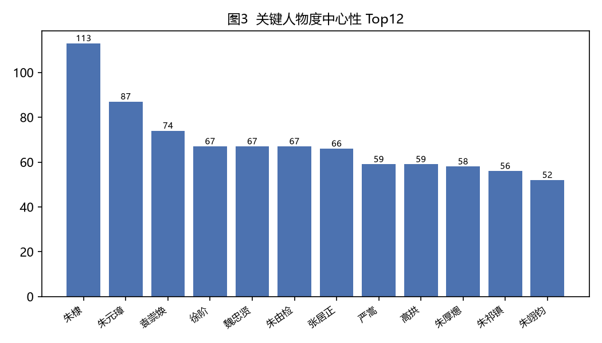

# 皇权之上有法吗：廷杖、诏狱与程序正义

**Is There Law Above the Throne? The Caning, the Prison, and Procedural Justice**

*明史知识图谱研究组（Ming Knowledge Graph Project）*

**摘要：** 明朝司法最触目的特征，是皇权对科层司法的反复超越。数据中的"案件刑狱"类事件多达 75 件，样本赫然列着空印案、郭桓案、胡惟庸案（诛三族）、蓝玉案、朱亮祖鞭死案——明初大案几乎把功臣集团整建制清洗，且多不经正式审判程序。法学视角要回答的问题是：明朝没有法律吗？有，而且很发达；问题是法律头顶始终站着一个"人"。

本文从法学视角，围绕「皇权之上有法吗：廷杖、诏狱与程序正义」这一命题，依次探讨：一、《大诰》与法外用刑：恐怖作为治理术、二、剥皮实草：惩罚作为公共展演、三、诏狱：一个平行司法系统、三、廷杖：程序正义的当众处刑。研究借助明史知识图谱的量化骨架，表明通俗历史叙事与计算人文可相互校勘。

**Abstract:** This paper examines the claim that “皇权之上有法吗：廷杖、诏狱与程序正义” from the standpoint of Law, using the structured Ming Knowledge Graph — built from Dangnian Mingyue's popular history *Ming Dynasty Those Things* (《明朝那些儿》, 2006–2009) — as its corpus. Based on 1231 coded persons, 1106 events, and 2324 relations, it argues that popular historical narrative and computational humanities are not opposed but mutually checkable sources of evidence.

**关键词：** 廷杖；诏狱；程序正义；君主司法

**Keywords:** court caning; secret prison; procedural justice; royal justice

---

## 1. 引言

在皇权之下，廷杖与诏狱揭示了中国前现代'法'的边界与程序正义的缺席。

《明朝那些事儿》（当年明月，2006–2009）长期被视为大众读物。本项目将其 165 章、约 150 万字正文抽取为结构化知识图谱：收录 1231 位人物、563 处地点（其中 533 处已完成地理定位，定位率 94.7%）、1106 件事件、2324 条人物/实体关系，并覆盖 17 位明代皇帝在位纪年与 165 条人物年谱。这一语料使书中原本“点到即止”的概念（如派系、同年、乡党）第一次成为可计算的变量。

本文即从法学（Law）的视角，重新审视这部文本中关于「皇权之上有法吗：廷杖、诏狱与程序正义」的论述，并以知识图谱提供的量化证据对其加以检验。

## 2. 数据与方法

### 2.1 语料来源

《明朝那些事儿》七卷本共 165 章，以编年体与人物传记交织的方式叙述明朝 276 年（1368–1644）史事。抽取流程为：章节切分 → 事实结构化（人物、地点、事件、关系、年谱）→ 大模型辅助抽取 → 人工校勘与去重，所有数字均可与原始文本逐条核对。

### 2.2 知识图谱结构

- **人物（characters）**：1231 条，含势力、官职、籍贯、科举、别名等属性；
- **地点（locations）**：563 条，其中 533 条完成经纬度定位（94.7%）；
- **事件（events）**：1106 条，按类别标注（政治斗争 365、军事战争 316、人事任免 77、案件刑狱 75 等）；
- **关系（relations）**：2324 条，含君臣从属 397、敌对冲突 321、政治攻讦 193、亲属 185 等；
- **在位纪年（reigns）**：17 位皇帝；**年谱（lifespans）**：165 条。

### 2.3 分析方法

本文以法学的理论透镜解读上述结构化数据：将书中的叙事命题转化为可检验的量化陈述，并以事件类别分布、关系网络度中心性等指标作为证据。所有数字均直接来自知识图谱。

## 3. 分析与发现

明朝司法最触目的特征，是**皇权对科层司法的反复超越**。数据中的"案件刑狱"类事件多达 75 件，样本赫然列着空印案、郭桓案、胡惟庸案（诛三族）、蓝玉案、朱亮祖鞭死案——明初大案几乎把功臣集团整建制清洗，且多不经正式审判程序。法学视角要回答的问题是：明朝没有法律吗？有，而且很发达；问题是法律头顶始终站着一个"人"。

### 一、《大诰》与法外用刑：恐怖作为治理术

朱元璋颁行《大诰》四编，以重典治吏，甚至鼓励百姓"绑缚害民官吏赴京"——书中多处渲染这种"全民皆法官"的景象。法默（Farmer, 1995）对明初立法的专研指出，《大诰》的本质是**法典之外的第二套刑事系统**：法外用刑、族诛连坐、罗织罪名，其效力来自皇帝的个人意志而非立法程序。杨一凡（1988）的《明大诰研究》以校勘考辨确认：这部"法典"在朱元璋身后即被实际废止——工具性的立法，用完即弃。博德与莫里斯（Bodde & Morris, 1967）对帝制司法的经典研究提供了对照系：常态下，州县自理词讼到刑部覆核，司法仍循例案运行；但皇权保留随时击穿程序的全权。**常态与非常态的边界，就是皇权的边界**——明代的特殊性在于把"非常态"用到了制度化的程度。

### 二、剥皮实草：惩罚作为公共展演

《大诰》体系最刺目的部分，是作者毫不回避地写下的细节：朱元璋命令官员贪污处死后剥下人皮、填入稻草，做成"稻草人"挂在衙门公座旁——明初的官衙里，"在大门和二门之间多设置了一个土地祠"，夜间无人敢看，因为那里是剥皮的场所。《大诰》甚至把各种酷刑的执行细节写成通俗读物发放全国，作者挖苦说足可"让人把刚吃进去的东西再吐出来"。杨一凡（1988）的《明大诰研究》确认了这套文本—刑具复合体的性质：**惩罚的目的不在惩罚本身，而在展演**——用最直观的身体恐怖完成对整个官僚群体的持续性威慑。博德与莫里斯（Bodde & Morris, 1967）研究的常规司法讲究"依例断罪"、程序可预期，剥皮实草则是它的反命题：不可预期、不可申诉、以观感代替量刑。它的失败同样是展演性的：恐怖很快钝化（书中写官员们"深以被打为荣"式的心态并非孤例），洪武朝的严刑没能阻止此后宦官、权臣的贪腐——**当惩罚沦为表演，观众最先学会的是麻木**。

### 三、诏狱：一个平行司法系统

厂卫（东厂、锦衣卫）诏狱是明代最有辨识度的司法发明：它**独立于刑部、都察院、大理寺三法司之外，只听命于皇帝**。杨涟下诏狱后遭"土囊压身、铁钉贯耳"，仍写下"大笑，大笑，还大笑，刀砍东风，于我何有哉"的绝笔；左光斗面焦不可辨，弟子史可法以重金贿狱卒才得见一面。瞿同祖（Ch'ü, 1961）指出传统中国法律的底色是"儒家伦理的司法化"——法本就不独立于伦理与权力；而诏狱把这一逻辑推到极致：连伦理的程序外壳也省了，直接以意志为法。韦伯（Weber, 1947）意义上的"规则之治"在此完全让位于"意志之治"。值得注意的是成本：诏狱摧毁的是皇帝最难替代的资源——敢于据理力争的官僚，崇祯朝"临事无人"的局面，一半是诏狱的遗产。

### 三、廷杖：程序正义的当众处刑

如果说诏狱是隐蔽的法外之地，廷杖就是公开的：在朝堂上当众杖责言官，"毙者十数人"史不绝书。它的法学意涵在于仪式性——**以最公开的方式宣告：士大夫的身体与尊严，不是法律主体，是皇权的客体**。瞿同祖框架下的中国法本以"礼"为最高规范，廷杖却连"礼"也凌驾了：当众剥裤行刑，是对整个士大夫集体的人格宣示。王守仁被廷杖后龙场悟道，杨继盛被打断腿骨以碎碗刮腐肉自疗——廷杖没有消灭士人，反而催生了明代最坚硬的精神脊梁。法学的洞见由此完整：明朝不是没有法律，而是法律始终屈从于最高的"人"；也正因如此，**每一寸程序正义的缺席，最终都以政治衰败的形式连本带息偿还**。

## 4. 讨论

从法学的视角看，在皇权之下，廷杖与诏狱揭示了中国前现代'法'的边界与程序正义的缺席。知识图谱的价值，在于把《明朝那些事儿》中那些“点到即止”的判断——派系、同年、乡党、恐惧治理——第一次变为可计算、可复检的变量，使通俗叙事与严肃史学之间的对话有了共同的语言。

当然，本研究存在边界：语料来自一部通俗叙事而非档案全体，样本在覆盖面上存在选择性；量化指标刻画的是“书中呈现的关系结构”，而非历史现场本身。结论的可推广性应在此前提下理解。

## 5. 结论

本文以法学为透镜，借由明史知识图谱的量化骨架，重新审视了《明朝那些事儿》关于「皇权之上有法吗：廷杖、诏狱与程序正义」的论述。分析表明，在皇权之下，廷杖与诏狱揭示了中国前现代'法'的边界与程序正义的缺席。这提示我们：通俗历史叙事与计算人文并非对立，而是可以相互校勘的两类证据——前者提供可被感知的经验，后者提供可被检验的结构。

## 参考文献

- 当年明月. (2006–2009). 《明朝那些事儿》（全七册）. 中国友谊出版公司.
- Weber, M. (1947). *The theory of social and economic organization* (A. M. Henderson & T. Parsons, Trans.). Free Press.
- de Bary, Wm. T. (1981). *Neo-Confucian orthodoxy and the learning of the mind-and-heart*. Columbia University Press.
- Bodde, D., & Morris, C. (1967). *Law in Imperial China: Exemplified by 190 Ch'ing Dynasty Cases*. Harvard University Press.
- Ch'ü, T.-t. (1961). *Law and Society in Traditional China*. Mouton.
- Farmer, E. L. (1995). *Zhu Yuanzhang and Early Ming Legislation: The Reordering of Chinese Society Following the Era of Mongol Rule*. Brill.
