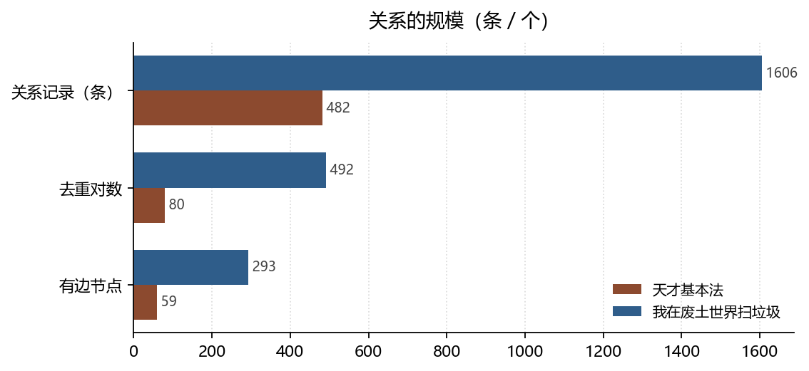

# 关系的两种写法：社交资本、孤立点与被重复计数的边

**Two Ways of Writing Relations: Social Capital, Isolates, and Repeated Edges**

*拆书项目组（Computational Reading of Two Novels）*

**摘要：**两本长篇小说的关系表分别有 482 条与 1606 条记录，但去重后只剩 80 对与 492 对——同一对人物被跨章重复记录，平均每对 6.03 条与 3.26 条。本文先纠正这个计数事实，再比较两书的关系结构：天才基本法是单星网络（1 个连通分量、58.6% 的人物零关系边），我在废土世界扫垃圾是有组织的多团块（6 个分量、最大分量占 74.7%）。同一套社会资本理论在两种结构里兑现方式完全不同：一个只能通过单一枢纽兑现，一个可以绕过枢纽。

**Abstract:** The two novels yield 482 and 1606 relation records, but only 80 and 492 unique undirected pairs remain after de-duplication. We first correct this counting artefact, then compare relational structure: Tiancai Jibenfa is a single-star network, while Wozai Feitu Shijie Sao Laji is a multi-cluster organisation. Social capital theory cashes out very differently in the two shapes.

**关键词：**关系社会学；社会资本；弱关系；孤立点；双文本对照

**Keywords:** sociology of relations; social capital; weak ties; isolates; comparative reading

---

## 1. 引言

把小说读成社会，最容易被误读的一个数字是「关系条数」。482 与 1606 这两个数字看起来像社交广度，实际上它们是**跨章重复计数**的产物：同一对人物在第 1 章、第 37 章、第 108 章各被抽取一次，就会产生三条记录。格兰诺维特（Granovetter, 1973）讨论弱关系时，关心的是「谁与谁相连」这个拓扑，而不是「相连被记录了几次」。本文因此先做一件不讨好的事：把重复去掉，再看结构。

## 2. 数据与方法

### 2.1 语料

《天才基本法》（长洱，221 章）与《我在废土世界扫垃圾》（有花在野，439 章）。两书经同一套抽取流程构建知识图谱：章节切分 → 人物/地点/事件/关系结构化 → 类型归约 → 校验。规模为人物 140 / 379，事件 833 / 2591，关系 482 / 1606，地点 256 / 1037。

### 2.2 去重口径

关系表按「无向对」去重：`(A,B)` 与 `(B,A)` 视为同一对，只保留一次。所有拓扑量（度、平均度、连通分量、孤立点）一律用去重口径；原始条数并列给出以便回查。这一步不是修饰，而是**结论方向会被它改写**：按原始条数排名，党爱萍会以 59 条边进入核心圈；按去重口径，她只有 3 个邻居。

### 2.3 边界

孤立点大多是只出场一章的龙套，这属于**抽取值域**问题，不能读作「书中人物孤僻」。本文只对「有边人物」的内部结构下结论。

*数据来源：本项目知识图谱现算；口径见 §2。*

## 3. 分析与发现

### 3.1 关系表的条数不是社交广度

**结论**：天才 482 条关系只覆盖 80 个唯一对（平均每对 6.03 条）；废土 1606 条覆盖 492 对（3.26 条/对）。

> 可信度：高 ｜ 性质：实测 ｜ 证据：`relations[].from/to` 无向去重，分母 482 / 1606 ｜ 来源：`relations.json`

两书的重复强度差了近一倍。天才的重复来自「平行世界重演」——草莓世界与芝士世界的同一场景被各记一次，因此同一对关系反复出现；废土的重复更接近「长期同行」——队友关系在数百章里持续存在，每章各记一次。**同一个计数现象，背后是两种叙事机制**（此句为推断，可信度中）。

### 3.2 一个星，与六个团块

**结论**：天才的关系图是 1 个连通分量、最大分量 59 人（42.1%），中心是林朝夕（度 29），度=1 的节点占 67.8%；废土是 6 个分量、最大分量 283 人（74.7%），中心是祝宁（度 126），度=1 占 51.9%。

> 可信度：高 ｜ 性质：实测 ｜ 证据：去重后建图，节点 59 / 293，平均度 2.71 / 3.36 ｜ 来源：`relations[]` + `characters[]`

天才有 82 人（58.6%）完全没有关系边，废土 119 人（31.4%）。这组差距比中心度更能说明体裁差异：校园叙事把绝大多数人写成「同班同学」这种**无差别背景**，组织叙事则必须给每个人一个位置（队友、上下级、交易对象）。废土的关系基类里出现了天才完全没有的三类：交易 40、支配 48、寄生 8。

### 3.3 别名是关系位置的标记，不是同义词

**结论**：天才 166 个别名覆盖 40% 的人物；废土 479 个覆盖 53%。

> 可信度：高 ｜ 性质：实测 ｜ 证据：`characters[].aliases` 长度统计 ｜ 来源：`characters.json`

一个人被叫「老林」「林爸爸」「公园看门老大爷」，不是三个名字，是三个**关系位置**。林（Lin, 2001）把这种可动员的关系称为社会资本：它的价值不在名单长度，而在「谁能以什么名义调用谁」。天才的别名密度低于废土，但别名的**跨度**更大（从亲属称谓到职业称谓），这与单星结构一致——所有关系都要经过同一个枢纽，于是枢纽必须拥有多种身份。

## 4. 讨论

斯科特（Scott, 2017）区分公开文本与隐藏文本：弱者在大人物面前表演顺从，在背后另有一套话语。这套框架在废土比在天才更适用——废土有 267 条上下级关系与 48 条支配关系，等级是明写的；天才的等级是分数排名，明写但可推翻。**当等级可以被考试推翻时，隐藏文本的需求就下降了**，这或许是天才的「冲突」多为公开竞争的原因。

本研究的边界很清楚：图谱记录的是「书里写了谁与谁有关」，不是「人物在虚构世界里真实的社会网」。抽取偏向有名字、有台词、有互动的人，沉默者会被系统性漏掉。

## 5. 结论

两本书的关系结构不能用一个「关系条数」概括。去掉重复计数之后，一个是围绕单一枢纽的星形网络，一个是多团块的组织网络；同样叫「社会资本」，前者只能通过枢纽兑现，后者可以绕过枢纽自组织。**计数口径的纠正不是技术细节，它决定了我们看见的是一个人，还是一个社会。**

## 参考文献

- Granovetter, M. S. (1973). The Strength of Weak Ties. *American Journal of Sociology*, *78*(6), 1360–1380. https://doi.org/10.1086/225469
- Lin, N. (2001). *Social Capital*. Cambridge University Press. https://doi.org/10.1017/cbo9780511815447
- Scott, J. C. (2017). *Domination and the Arts of Resistance*. Yale University Press. https://doi.org/10.12987/9780300153569

> 文献核验：以上 3 条均由 `src/verify_refs.py` 逐条检索 Crossref，命中类型、年份、作者与标题相似度四道闸后才写入；DOI 可直接打开原记录。少数专著在 Crossref 的注册题名省略了副标题，以注册记录为准。
