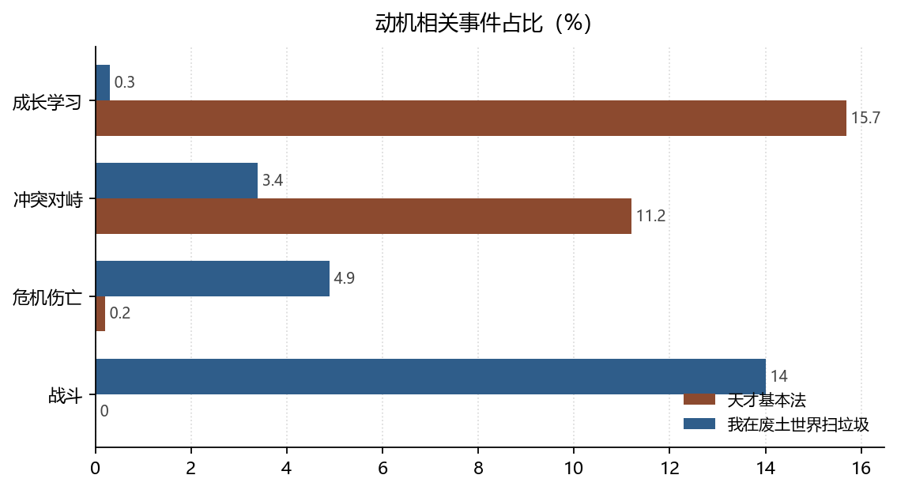

# 动机的两种来源：掌握体验与生存压力

**Two Sources of Motivation: Mastery Experience and Survival Pressure**

*拆书项目组（Computational Reading of Two Novels）*

**摘要：**天才基本法里「成长学习」占事件的 15.7%，我在废土世界扫垃圾只有 0.3%——但这不是「谁更爱学习」，而是两种动机被叙述成了不同的事件类型。本文用自我决定理论、自我效能与能力信念三条线索拆解这个差距：天才的动机来自掌握体验（可重复的失败与修正），废土的动机来自生存压力（不可协商的伤亡，4.9% 对 0.2%）。两者都成立，但它们不是同一种心理机制。

**Abstract:** Learning events account for 15.7% of events in Tiancai Jibenfa but only 0.3% in the wasteland novel. This is not a difference in diligence but in how motivation is narrated. Using self-determination theory, self-efficacy, and implicit theories of ability, we show that the former rests on mastery experience while the latter rests on survival pressure.

**关键词：**自我决定理论；自我效能；能力信念；动机；双文本对照

**Keywords:** self-determination theory; self-efficacy; implicit theories; motivation; comparative reading

---

## 1. 引言

一个读者很容易从「成长学习事件占 15.7%」推出「这本书更励志」。这个推论在方法上是错的：事件类型是**归约**的结果，同一件事可以被归成「学习」也可以被归成「战斗」。本文因此不比较绝对密度，而比较**动机被写成什么形状**：失败是否可修正、能力是否可增长、他人的支持是否可预期。

## 2. 数据与方法

### 2.1 语料与规模

两书分别为 221 章 / 833 事件 / 140 人，与 439 章 / 2591 事件 / 379 人。事件按 15 个叙事功能基类归约（战斗、冲突对峙、成长学习、危机伤亡、情报对话等），归约词表由两书共用。

### 2.2 三个可操作指标

- **掌握体验**：归为「成长学习」的事件数及其占比——对应班杜拉（Bandura, 1977）所说的效能感最主要的来源；
- **能力信念**：失败后是否出现「再试一次」结构，用「冲突对峙」与「成长学习」的比值近似；
- **关系性支持**：救助关系的去重对数——对应自我决定理论中的 relatedness（Ryan & Deci, 2000）。

### 2.3 边界

归约词表对「打斗」敏感、对「顿悟」不敏感。废土的修炼与升级大量落在「战斗」「副本任务」里（14% + 14.4%），不会被计入成长学习。因此**跨书的成长学习占比不可直接比较**，只能比较其内部构成。

*数据来源：本项目知识图谱现算；口径见 §2。*

## 3. 分析与发现

### 3.1 成长事件被写成了两种东西

**结论**：天才「成长学习」131 件（15.7%），废土 7 件（0.3%）；而废土的「战斗」363 件（14%）、「副本任务」373 件（14.4%）在天才几乎为零。

> 可信度：高 ｜ 性质：实测（占比属归约口径）｜ 证据：`events[].type_base` 计数，分母 833 / 2591 ｜ 来源：`events.json`

把三类合并看，两书的「能力增长事件」并没有数量级差距；差距在**增长被放在哪一类里**。天才的增长发生在教室与书桌前，可以被命名、被评分、被复述；废土的增长发生在战斗里，只能通过「活下来」被证明。这正是德韦克（Dweck & Leggett, 1988）所说能力信念的分野：前者是**渐进论**（能力可通过努力增长），后者更接近**实体论**的变体——能力是既成的，考验只是筛选。

### 3.2 失败的可修复性差 25 倍

**结论**：天才「危机伤亡」2 件（0.2%），废土 128 件（4.9%），相差约 25 倍；同期「冲突对峙」天才 11.2%、废土 3.4%。

> 可信度：高 ｜ 性质：实测 ｜ 证据：同 3.1 ｜ 来源：`events[].type_base`

天才的冲突密度反而更高（11.2% 对 3.4%），但几乎不产生伤亡；废土反过来，冲突少而代价重。这组反向数字说明：**冲突的频率与冲突的后果是两件事**。天才的冲突是「考试名次、竞赛名额、举报」，输了可以再来；废土的冲突一旦发生就可能死人。班杜拉意义上的掌握体验需要一个安全失败的环境，而废土从结构上不提供这个环境。

### 3.3 支持是可预期还是可遇不可求

**结论**：天才救助关系去重后仅 8 个有向对（其中双向 1 对），废土 52 对（双向 7 对）。

> 可信度：高 ｜ 性质：实测 ｜ 证据：`relations[].rel_base == "救助"` 去重 ｜ 来源：`relations.json`

天才的救助高度集中：8 个对里，主角一侧占了绝大多数（详见报告「伦理学」一节）。这意味着支持**可预期但不可选择**——保护来自固定的几个人。废土的救助分散在 52 个对上，支持来自组织，可替换但需要交换。自我决定理论把 relatedness 视为基本需求，但两书给出的满足方式不同：一个是关系性的，一个是制度性的。

## 4. 讨论

把这三条放在一起，可以看到一个反直觉的结论：**励志感不来自成长事件的数量，而来自失败的可修复性**。天才的成长事件密度高，本质上是因为它允许角色反复失败；废土的成长事件少，是因为它的世界不允许失败被重复。读者感到「燃」的机制，可能正是这种「输了还能再来」的结构性许可。

研究的边界在于：事件类型由词表归约，词表本身带有体裁偏向。若要更严格地比较动机，需要逐事件标注「是否有再次尝试」这一行为特征，而不是依赖类型标签。

## 5. 结论

两本书写的是两种动机：一种建立在掌握体验上，失败可重复、能力可增长；一种建立在生存压力上，能力是既成的、考验只做筛选。把它们放在同一个「励志」标尺上比较是不成立的；但拆开看，两者的心理机制都清晰可辨——**一个写的是如何变强，一个写的是如何不死**。

## 参考文献

- Bandura, A. (1977). Self-efficacy: Toward a unifying theory of behavioral change. *Psychological Review*, *84*(2), 191–215. https://doi.org/10.1037/0033-295x.84.2.191
- Dweck, C. S., & Leggett, E. L. (1988). A social-cognitive approach to motivation and personality. *Psychological Review*, *95*(2), 256–273. https://doi.org/10.1037/0033-295x.95.2.256
- Ryan, R. M., & Deci, E. L. (2000). Self-determination theory and the facilitation of intrinsic motivation, social development, and well-being. *American Psychologist*, *55*(1), 68–78. https://doi.org/10.1037/0003-066x.55.1.68

> 文献核验：以上 3 条均由 `src/verify_refs.py` 逐条检索 Crossref，命中类型、年份、作者与标题相似度四道闸后才写入；DOI 可直接打开原记录。少数专著在 Crossref 的注册题名省略了副标题，以注册记录为准。
