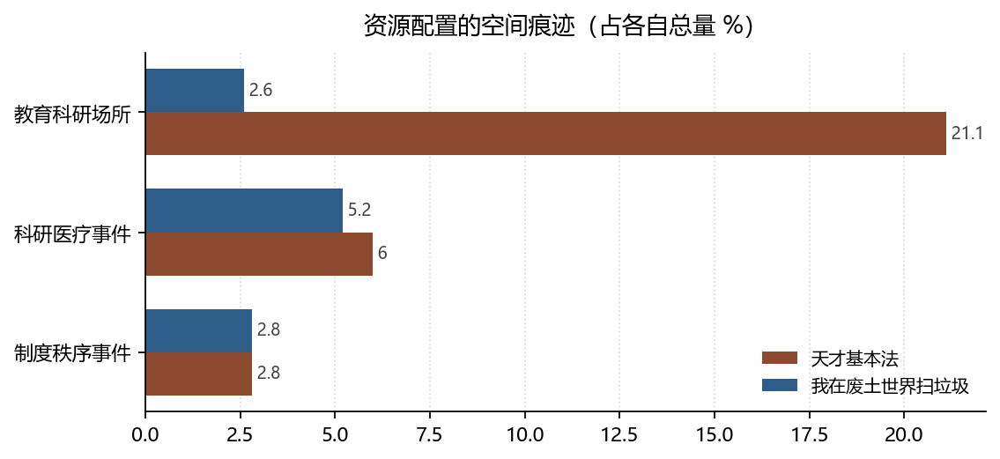

# 人力资本与配给制：两种资源配置的叙事

**Human Capital and Rationing: Two Narratives of Resource Allocation**

*拆书项目组（Computational Reading of Two Novels）*

**摘要：**天才基本法把资源问题写成「投资」：教育科研场所占 21.1%，科研医疗事件占 6%，回报延迟但可预期。我在废土世界扫垃圾把资源问题写成「配给」：交易关系 40 条、支配关系 48 条、撤离救援 31 件，而天才这两类关系各为 0。本文用人力资本与公共池塘资源两套框架说明：同一个「稀缺」在不同叙事里被制度化了两次，一次通过考试，一次通过配给。

**Abstract:** Tiancai Jibenfa narrates scarcity as investment (21.1% of locations are educational), while the wasteland novel narrates it as rationing (40 exchange and 48 domination relations, against zero in the former). We read the two regimes through human capital theory and commons governance.

**关键词：**人力资本；公共池塘资源；交易关系；教育投入；双文本对照

**Keywords:** human capital; commons; exchange relations; educational investment; comparative reading

---

## 1. 引言

经济学在文学研究里常被当作隐喻使用。贝克尔（Becker, 1962）把教育支出视为一种投资，其回报延迟但可计算；这个框架恰好能解释一本书的选择，却解释不了另一本。两本书提供了可以直接计数的东西：谁在什么地方、以什么名义、把资源给谁。教育场所的比例、交易关系的条数、救援事件的分布，都是**配置机制的痕迹**。本文不问「哪本书更批判现实」，只问：稀缺在两书中被哪种制度处理。

## 2. 数据与方法

### 2.1 语料

《天才基本法》221 章 / 833 事件 / 256 地点；《我在废土世界扫垃圾》439 章 / 2591 事件 / 1037 地点。地点按 9–13 个功能基类归约（据点驻地、教育科研、商业服务、医疗场所、管制边界等）。

### 2.2 三个指标

- **投入强度**：教育科研与科研医疗类目的占比（对应 Becker, 1962 的人力资本投资）；
- **交换形式**：交易 / 支配 / 救助三类关系的条数与去重对数（对应 Ostrom, 1990 的资源配置规则）；
- **制度密度**：「制度秩序」事件占比，衡量规则被叙述的频次。

### 2.3 边界

两书的地点粒度不同（256 对 1037），百分比可比较、绝对数不可比较。关系条数存在跨章重复，本文同时给出去重值。

*数据来源：本项目知识图谱现算；口径见 §2。*

## 3. 分析与发现

### 3.1 天才把稀缺投进教室，废土把它摊在路上

**结论**：教育科研类地点天才 54 处（21.1%），废土 27 处（2.6%）；科研医疗事件 50 件（6%）对 135 件（5.2%）。

> 可信度：高 ｜ 性质：实测 ｜ 证据：`locations[].type_base`、`events[].type_base` ｜ 来源：`locations.json` / `events.json`

天才的稀缺是「名额」：好学校、竞赛资格、导师时间，都要通过考试分配，因此叙事必须把空间集中在教室与办公室。废土的稀缺是「物资与安全」，空间摊开在据点、交通通道与遗迹之间（据点驻地 312 处、交通通道 123 处、遗迹尸骸 40 处）。**空间分布是配置机制的直接投影**。

### 3.2 一个有交易，一个只有赠予

**结论**：废土有交易关系 40 条、支配关系 48 条、寄生关系 8 条；天才在这三类上均为 0，其救助关系 58 条（去重后 8 对）。

> 可信度：高 ｜ 性质：实测 ｜ 证据：`relations[].rel_base` 计数与去重 ｜ 来源：`relations.json`

这是全书最干净的一组对照。天才的资源配置不通过交换完成，而通过**赠予与保护**：父亲教女儿、老师带学生、福利院收养孤儿。赠予的特征是不可计价，也因此不可积累——你无法用「被教了三次」去换「一次名额」。废土则有明确的可计价关系：交易 40 条意味着存在价格，支配 48 条意味着存在强制，两者共同构成配给制的两端。奥斯特罗姆（Ostrom, 1990）讨论公共池塘资源时强调，规则是否被参与者自己制定，决定了资源能否持续；废土的制度秩序事件 72 件（2.8%）正是这套规则的叙述痕迹。

### 3.3 制度密度相同，制度内容相反

**结论**：两书「制度秩序」占比都是 2.8%（23 件对 72 件），但天才集中在校园段落，废土集中在管制边界与据点。

> 可信度：中 ｜ 性质：推断（占比为实测，集中度为阶段分布推断）｜ 证据：同 3.1 ｜ 来源：`events[].type_base` × 阶段轴

占比相同是巧合，含义相反：天才的制度是**评分规则**（谁被允许参加考试），废土的制度是**准入规则**（谁能进哪个据点）。前者可以申诉，后者只能服从。这一条的可信度只到「中」——阶段分布的分母较小，单段样本容易波动。

## 4. 讨论

把两书并置，会看到人力资本理论的一个隐含前提被抽掉了。贝克尔模型假定投资可以延迟回报：今天读书，明天收益。天才完整地保留了这一前提，甚至把它写成信念（「数学不会骗人」）。废土则把这个前提拆了：如果明天不一定到来，投资就退化为储备，储备再退化为配给。**同一套经济学，在两种时间结构里给出相反的理性**。

边界在于：本文只统计「被叙述为经济行为」的事件，书中大量隐含的资源流动（家务、照护、情感劳动）没有进入图谱。这部分劳动的缺席本身值得另文讨论。

## 5. 结论

天才基本法用投资叙述稀缺，我在废土世界扫垃圾用配给叙述稀缺。前者的核心制度是考试，后者的核心制度是准入；前者的关系以赠予为主，后者的关系以交易与支配为主。两种叙事都成立，但它们对「未来是否可信」给出了不同答案——而这正是经济学叙事最深的假设。

## 参考文献

- Becker, G. S. (1962). Investment in Human Capital: A Theoretical Analysis. *Journal of Political Economy*, *70*(5, Part 2), 9–49. https://doi.org/10.1086/258724
- Ostrom, E. (1990). *Governing the Commons*. Cambridge University Press. https://doi.org/10.1017/cbo9780511807763

> 文献核验：以上 2 条均由 `src/verify_refs.py` 逐条检索 Crossref，命中类型、年份、作者与标题相似度四道闸后才写入；DOI 可直接打开原记录。少数专著在 Crossref 的注册题名省略了副标题，以注册记录为准。
