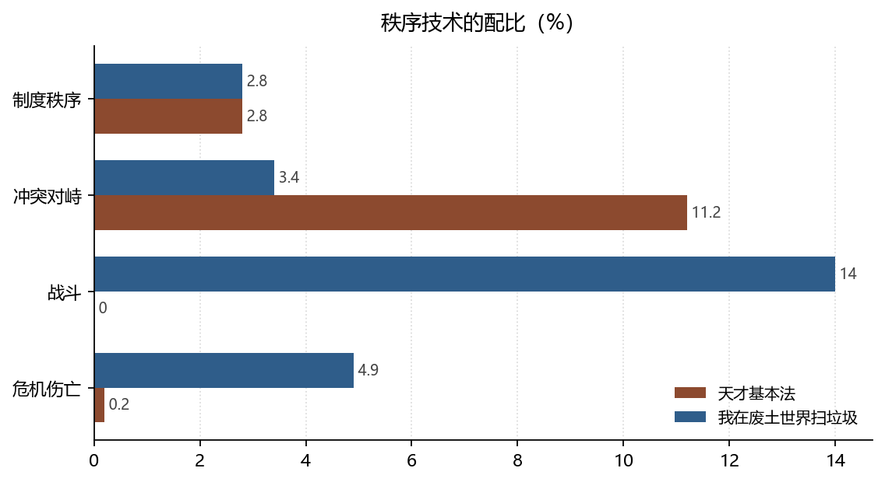

# 裁判、科层与暴力：三种秩序技术

**Referee, Hierarchy, and Violence: Three Technologies of Order**

*拆书项目组（Computational Reading of Two Novels）*

**摘要：**天才基本法的秩序由裁判维持：战斗事件 0 件、冲突 93 件却几乎无伤亡。我在废土世界扫垃圾的秩序由科层与暴力维持：战斗 363 件（14%）、上下级关系 267 条、支配关系 48 条，而天才的上下级关系只有 3 条。本文比较两书的秩序技术：一种把冲突收进规则，一种把规则交给暴力，第三种则是在规则边缘生长的密谋。

**Abstract:** Order in Tiancai Jibenfa is sustained by a referee (zero battles, 93 conflicts with almost no casualties); order in the wasteland novel is sustained by hierarchy and violence (363 battles, 267 superior-subordinate relations). We compare three technologies of order and the forms of resistance each permits.

**关键词：**权力形态；科层；暴力垄断；隐藏文本；双文本对照

**Keywords:** power; hierarchy; monopoly of violence; hidden transcripts; comparative reading

---

## 1. 引言

政治学的老问题是：秩序从哪里来。两本书给了三个不同答案，而且都能被计数——裁判（考试与排名）、科层（队伍与据点）、暴力（战斗与伤亡）。三者不是互斥的，但配比决定了一本书里「反抗」长什么样。

## 2. 数据与方法

### 2.1 语料

两书事件总量 833 与 2591，关系总量 482 与 1606（均含跨章重复，拓扑量另用去重口径）。事件按 15 个功能基类归约，关系按 17 个基类归约。

### 2.2 三个指标

- **暴力**：战斗事件数、危机伤亡事件数；
- **科层**：上下级 / 支配 / 队友三类关系条数；
- **异议**：密谋博弈与情报对话的事件占比，用斯科特（Scott, 2017）的「隐藏文本」框架读。

### 2.3 边界

「制度秩序」是归约标签，包含考试规则、据点规章、组织纪律等不同对象。本文用它做**密度**比较，不做**性质**判定；性质判定依赖具体事件，见报告「法学·秩序」一节。

*数据来源：本项目知识图谱现算；口径见 §2。*

## 3. 分析与发现

### 3.1 天才的暴力是零

**结论**：天才战斗事件 0 件（0%）、危机伤亡 2 件（0.2%），而冲突对峙 93 件（11.2%）；废土战斗 363 件（14%）、危机伤亡 128 件（4.9%）。

> 可信度：高 ｜ 性质：实测 ｜ 证据：`events[].type_base` 计数，分母 833 / 2591 ｜ 来源：`events.json`

零战斗是一个强事实：不是「战斗写得少」，而是一件都没有。天才的冲突全部发生在有裁判的场域里——考试、竞赛、评审、举报。裁判的存在使冲突可以高频（11.2%）而不致命（0.2%）。废土则相反：冲突密度低（3.4%），但一旦发生就进入战斗（14%）与伤亡（4.9%）。**暴力垄断者是谁，决定了冲突被记成哪一种事件。**

### 3.2 权威的形状：师生与科层

**结论**：天才师徒关系 123 条、上下级 3 条；废土上下级 267 条、队友 267 条、支配 48 条、师徒 29 条。

> 可信度：高 ｜ 性质：实测 ｜ 证据：`relations[].rel_base` 计数 ｜ 来源：`relations.json`

天才的权威是**知识型**的：老师与学生的关系（123 条）远多于行政上下级（3 条）。这种权威可以被质疑——只要学生的解题更强。废土的权威是**职位型**的：上下级与队友两类合计 267+267 条，构成一张稳定的指挥链。奥斯特罗姆（Ostrom, 1990）指出，自治规则能否持续，取决于成员是否参与制定；废土的指挥链显然不是自治的，而是生存压力下形成的。

### 3.3 密谋是弱势者的政治语言

**结论**：废土密谋博弈 207 件（8%）、情报对话 235 件（9.1%）；天才分别为 10 件（1.2%）与 27 件（3.2%）。

> 可信度：高 ｜ 性质：实测 ｜ 证据：`events[].type_base` ｜ 来源：`events.json`

废土的信息类事件占比接近两成，其中密谋占 8%。斯科特（Scott, 2017）把这种「背后说的话」称为隐藏文本：它出现在权力不对等且公开申诉无用的场合。天才的密谋只有 1.2%，因为它的权力不对等可以被考试翻转——**当申诉渠道存在时，密谋的必要性下降**。这不是说天才的世界更公正，而是说它提供了一个可以表演公正的舞台。

## 4. 讨论

三种秩序技术对应三种反抗形式：在裁判秩序里，反抗是「考得更好」；在科层秩序里，反抗是「密谋与站队」；在暴力秩序里，反抗是「活下来」。把这三者混为一谈，就会误读人物的动机——把天才的竞争读成内卷，把废土的密谋读成阴谋。

本研究的边界是：图谱只记录被叙述的政治行为，不记录「未被叙述的服从」。而服从恰恰是秩序最日常的部分。要研究它，需要标注「未发生冲突的互动」，这超出了当前抽取的范围。

## 5. 结论

天才基本法用裁判维持秩序，我在废土世界扫垃圾用科层与暴力维持秩序，两者之间还有一层由密谋构成的灰色地带。秩序的形态决定了反抗的语法：**一个世界里的人想着怎么赢，另一个世界里的人想着怎么活。**

## 参考文献

- Ostrom, E. (1990). *Governing the Commons*. Cambridge University Press. https://doi.org/10.1017/cbo9780511807763
- Scott, J. C. (2017). *Domination and the Arts of Resistance*. Yale University Press. https://doi.org/10.12987/9780300153569

> 文献核验：以上 2 条均由 `src/verify_refs.py` 逐条检索 Crossref，命中类型、年份、作者与标题相似度四道闸后才写入；DOI 可直接打开原记录。少数专著在 Crossref 的注册题名省略了副标题，以注册记录为准。
