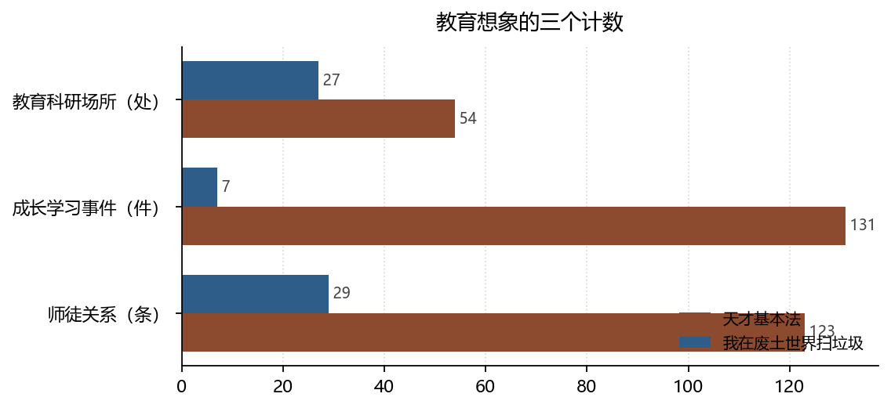

# 学校的两副面孔：选拔装置与缺席的课堂

**Two Faces of Schooling: Selection Apparatus and the Absent Classroom**

*拆书项目组（Computational Reading of Two Novels）*

**摘要：**天才基本法是一本关于考试的小说：教育科研场所占 21.1%，成长学习事件占 15.7%，师徒关系 123 条。我在废土世界扫垃圾则几乎取消了学校：教育科研场所只占 2.6%，成长学习 7 件，师徒 29 条。本文讨论这两种教育想象的代价：一个把学习制度化到极致，一个让学习退回到学徒制与生存训练。

**Abstract:** Tiancai Jibenfa is a novel about examinations (21.1% of locations educational, 15.7% learning events), whereas the wasteland novel almost abolishes schooling (2.6%, 7 events). We examine what each imaginary gains and loses.

**关键词：**教育社会学；制度化教育；内在动机；师徒制；双文本对照

**Keywords:** sociology of education; institutionalised schooling; intrinsic motivation; apprenticeship; comparative reading

---

## 1. 引言

教育学讨论「学校是什么」时，通常有两个答案：选拔装置，或启蒙场所。两本小说的选择恰好分列两端——一本把学校写成全部世界的中心，一本让学校几乎不存在。本文用可计数的证据描述这两种想象，并追问各自的代价。

## 2. 数据与方法

### 2.1 语料

天才 221 章 / 256 地点 / 833 事件；废土 439 章 / 1037 地点 / 2591 事件。地点与事件使用同一套功能基类，便于跨书比较。

### 2.2 三个指标

- **教育空间占比**：教育科研类地点 / 全部地点；
- **学习事件密度**：成长学习类事件 / 全部事件；
- **师徒关系**：`relations[].rel_base == "师徒"` 的条数（含跨章重复，仅作量级参考）。

### 2.3 边界

「成长学习」标签偏向「有明确教学关系」的事件，自学、顿悟、临场应变可能不被计入。因此废土的低值应读作「学习没有被写成教学」，而不是「没有学习」。

*数据来源：本项目知识图谱现算；口径见 §2。*

## 3. 分析与发现

### 3.1 一个把学校放大，一个把学校删掉

**结论**：教育科研类地点天才 54 处（21.1%），废土 27 处（2.6%）；成长学习事件 131 件（15.7%）对 7 件（0.3%）。

> 可信度：高 ｜ 性质：实测 ｜ 证据：`locations[].type_base`、`events[].type_base` ｜ 来源：`locations.json` / `events.json`

差距是两个数量级。天才的世界由学校组织：教室、办公室、考场、竞赛场地，人物的行动半径基本不出校园。废土的世界由据点与荒野组织，学校作为制度几乎不存在，知识以「老手带新手」的方式传递。伊里奇（Illich, 1995）批评制度化教育把学习变成消费，主张以「学习网络」取代学校；废土无意中实现了他的设想的一面——没有学校，只有现场；但也暴露了另一面：没有学校，也就没有可以被公平分配的入场券。

### 3.2 师徒是两书唯一共享的教育关系

**结论**：天才师徒关系 123 条，废土 29 条；相对地，天才上下级 3 条，废土 267 条。

> 可信度：中 ｜ 性质：实测（含跨章重复，仅作量级）｜ 证据：`relations[].rel_base` ｜ 来源：`relations.json`

师徒是唯一在两书中都稳定存在的关系类型，这提示它可能是比学校更基础的叙事装置：一个知道的人，一个不知道的人，一段不可替代的传授。差别在于结果——天才的师徒关系通向考试与学历，废土的师徒关系通向活命。同样是「教」，一个教的是可迁移的符号能力，一个教的是不可迁移的处境知识。

### 3.3 内在动机需要安全的环境

**结论**：天才「冲突对峙」11.2% 而「危机伤亡」0.2%；废土「冲突对峙」3.4% 而「危机伤亡」4.9%。

> 可信度：高 ｜ 性质：实测 ｜ 证据：`events[].type_base` ｜ 来源：`events.json`

瑞安与德西（Ryan & Deci, 2000）指出，内在动机依赖自主、胜任、归属三种体验，而三者都需要一个**允许失败**的环境。天才提供了这个环境（伤亡近乎为零），所以它的学习可以出于兴趣；废土不提供，所以它的学习只能出于必要。德韦克（Dweck & Leggett, 1988）的「渐进论」在这里也有了社会条件：相信能力可以增长，前提是失败不会致命。

## 4. 讨论

两种教育想象的代价是互补的。制度化教育能分配机会，但把学习异化为筛选，天才里那句「考试是唯一公平的事」既是信念也是控诉；非制度化教育保留了学习的实践性，却让机会随出身与运气分配。**小说没有解决这个矛盾，它们只是把矛盾的两端各自写到底。**

研究的边界：本文没有分析教师形象、课程内容与评价方式，这三者才是教育社会学的核心。图谱能提供的是空间与事件的骨架，具体教学互动的质地仍需细读。

## 5. 结论

天才基本法把学校写成命运的唯一入口，我在废土世界扫垃圾把学校写成已经失效的旧制度。前者证明了制度化教育的力量，后者证明了它的脆弱。两本书合起来，恰好构成一份关于「教育能做什么、不能做什么」的对照实验。

## 参考文献

- Dweck, C. S., & Leggett, E. L. (1988). A social-cognitive approach to motivation and personality. *Psychological Review*, *95*(2), 256–273. https://doi.org/10.1037/0033-295x.95.2.256
- Illich, I. (1995). *Deschooling Society*. Equinox Publishing Ltd.. https://doi.org/10.1558/isbn.9780714520704
- Ryan, R. M., & Deci, E. L. (2000). Self-determination theory and the facilitation of intrinsic motivation, social development, and well-being. *American Psychologist*, *55*(1), 68–78. https://doi.org/10.1037/0003-066x.55.1.68

> 文献核验：以上 3 条均由 `src/verify_refs.py` 逐条检索 Crossref，命中类型、年份、作者与标题相似度四道闸后才写入；DOI 可直接打开原记录。少数专著在 Crossref 的注册题名省略了副标题，以注册记录为准。
