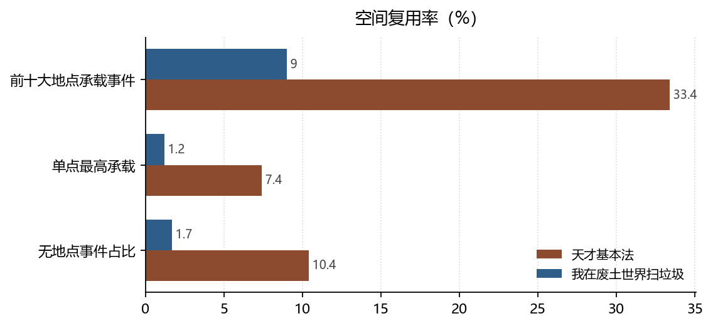

# 定点叙事与移动叙事：空间复用率的两种极端

**Fixed-point versus Mobile Narrative: Two Extremes of Spatial Reuse**

*拆书项目组（Computational Reading of Two Novels）*

**摘要：**天才基本法 256 处地点只承载 833 件事件，前十大场景占 33.4%，单个「院长办公室」就占 7.4%；我在废土世界扫垃圾 1037 处地点承载 2591 件事件，前十大场景只占 9%，最高的一处仅 1.2%。前者是定点叙事，后者是移动叙事。空间复用率的差距，直接决定了两本书的读者体验与人物关系形态。

**Abstract:** With 256 locations and 833 events, Tiancai Jibenfa concentrates 33.4% of events in ten scenes, one office alone taking 7.4%. The wasteland novel spreads 2591 events over 1037 locations, with only 9% in its top ten. The contrast separates fixed-point from mobile narrative.

**关键词：**空间社会学；场所；场景复用；坐标缺失；双文本对照

**Keywords:** sociology of space; place; scene reuse; missing coordinates; comparative reading

---

## 1. 引言

吉里恩（Gieryn, 2000）提醒社会学家：地点不是事件的背景板，而是被社会过程生产出来的东西，同时反过来塑造社会关系。两本小说对「地点」的使用几乎相反——一本反复回到同一个房间，一本不断离开。这种差异可以被量化：场景复用率。

## 2. 数据与方法

### 2.1 语料

天才：256 处地点 / 833 件事件；废土：1037 处地点 / 2591 件事件。地点按功能基类归约（据点驻地、居住空间、教育科研、交通通道、自然地貌、管制边界、遗迹尸骸等）。

### 2.2 指标

- **场景复用率**：前十大地点承载的事件数 / 有地点事件数；
- **单点强度**：承载事件最多的地点所占比例；
- **无地点事件**：`events[].location` 为空的事件数（衡量叙述的空间依附度）。

### 2.3 边界

坐标状态必须说明：天才 256 处、废土 1037 处**全部没有真实经纬度**，报告内地图为示意。因此本文只讨论「场景之间的关系」，不讨论现实地理。地点匹配采用精确名称匹配，别称不计入，复用率因此是**下限**。

*数据来源：本项目知识图谱现算；口径见 §2。*

## 3. 分析与发现

### 3.1 一个办公室装下了 7.4% 的事件

**结论**：天才事件最集中的地点是「院长办公室」，62 件（7.4%）；前十大地点合计 278 件（33.4%）。废土最集中的是「教堂（意识体云端）」，30 件（1.2%）；前十合计 9%。

> 可信度：高 ｜ 性质：实测 ｜ 证据：`events[].location` 与 `locations[].name` 精确匹配，分母 833 / 2591 ｜ 来源：`events.json` / `locations.json`

33.4% 对 9%，差了三倍多。天才的空间是**高压复用**的：一个办公室既是办公场所、又是谈话场所、又是秘密被揭穿的地方，同一空间承担多种功能，读者因此获得熟悉感。废土的空间是**低复用**的：每进入一个新区域就换一批场景，读者获得的是探索感。这两种体验对应两种叙事经济——前者省场景、换深度，后者费场景、换广度。

### 3.2 空间类型的两种配方

**结论**：天才的地点以据点驻地（69 处，27%）与教育科研（54 处，21.1%）为主，医疗场所只有 2 处；废土以据点驻地（312 处，30.1%）、居住空间（172 处）、交通通道（123 处）、自然地貌（123 处）为主，并有天才完全没有的「管制边界」40 处与「遗迹尸骸」40 处。

> 可信度：高 ｜ 性质：实测 ｜ 证据：`locations[].type_base` ｜ 来源：`locations.json`

「管制边界」与「遗迹尸骸」这两个类目只在废土出现，它们本身就是世界观声明：一个有边界要守，一个有尸体要清。天才没有这两个类目，因为它的世界不需要用边界与尸体来定义危险。**地点的类型表，就是世界的类型表。**

### 3.3 无地点事件的比例

**结论**：天才 87 件事件没有地点（87 / 833），废土 45 件。

> 可信度：高 ｜ 性质：实测 ｜ 证据：`events[].location` 为空 ｜ 来源：`events.json`

绝对数差距大，但比例都不高。这说明两书的叙述都高度依附于具体场所——即便是废土的移动叙事，事件也总要发生在某个地方。这一点常被忽视：**「移动」不等于「无地点」，只是地点不断更换**。

## 4. 讨论

空间复用率可以解释一个阅读体验上的差异：读天才时，读者脑中会形成一张很小的地图，几个房间反复出现，人物在其中的位置本身就是信息（谁坐在谁的对面）；读废土时，地图不断扩张，读者记住的是「去过哪类地方」而不是「哪个房间」。前者接近舞台剧，后者接近公路片。

边界在于：地点抽取偏向有名字的场所，走廊、街道这类过渡空间大量遗漏。若把它们补上，废土的移动叙事会更明显，天才的定点叙事则变化不大。

## 5. 结论

天才基本法用 256 处地点讲一个高度集中的故事，我在废土世界扫垃圾用 1037 处地点讲一个不断扩张的故事。空间不是背景，它是叙事节奏的物理形态：**复用率高的书，时间在同一个房间里流逝；复用率低的书，时间在移动中流逝。**

## 参考文献

- Gieryn, T. F. (2000). A Space for Place in Sociology. *Annual Review of Sociology*, *26*(1), 463–496. https://doi.org/10.1146/annurev.soc.26.1.463

> 文献核验：以上 1 条均由 `src/verify_refs.py` 逐条检索 Crossref，命中类型、年份、作者与标题相似度四道闸后才写入；DOI 可直接打开原记录。少数专著在 Crossref 的注册题名省略了副标题，以注册记录为准。
