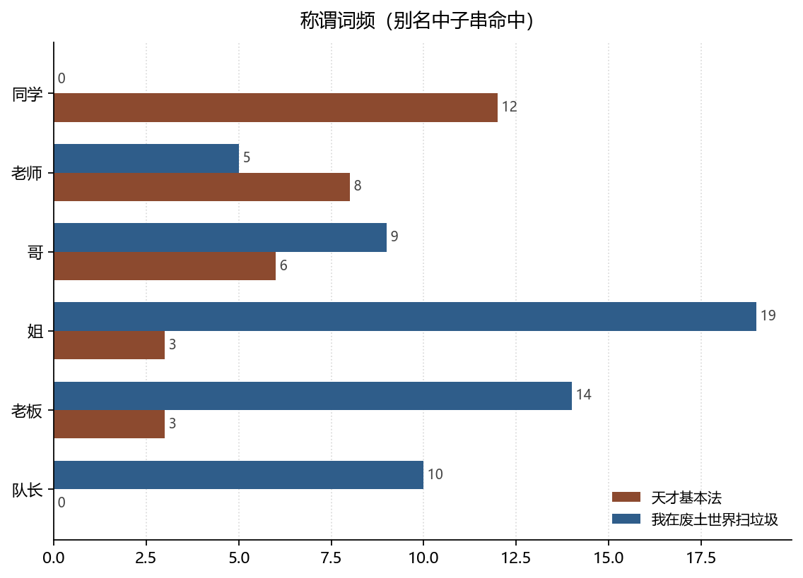

# 称谓的语法：谁被叫「同学」，谁被叫「姐」

**The Grammar of Address: Who Is Called Classmate, Who Is Called Sister**

*拆书项目组（Computational Reading of Two Novels）*

**摘要：**两书共 166 与 479 个别名，覆盖 40% 与 53% 的人物。称谓词表统计显示：天才基本法以「同学」12 次、「叔」9 次、「老师」8 次为主；我在废土世界扫垃圾以「姐」19 次、「老板」14 次、「队长」10 次为主。称谓不是同义词，而是关系位置的编码——它标记的是「谁有资格怎么叫谁」。

**Abstract:** Across 166 and 479 aliases, address terms cluster differently: classroom terms dominate in Tiancai Jibenfa, while kinship-and-rank terms dominate in the wasteland novel. Following politeness theory, we read aliases as encodings of relational position rather than lexical variants.

**关键词：**社会语言学；称谓；礼貌策略；别名；双文本对照

**Keywords:** sociolinguistics; terms of address; politeness; aliases; comparative reading

---

## 1. 引言

一个人被怎么称呼，取决于三件事：谁在叫、在什么场合叫、彼此的地位差多少。布朗与列文森（Brown & Levinson, 1987）把这些因素概括为礼貌策略：称呼既可以拉近距离，也可以标记距离。小说里的别名因此不是文本噪音，而是**社会关系的压缩编码**。

## 2. 数据与方法

### 2.1 语料

天才 140 位人物、166 个别名；废土 379 位人物、479 个别名。别名由抽取阶段从正文收集，含昵称、职称、亲属称谓、外号。

### 2.2 方法

- **覆盖**：有至少一个别名的人物比例；
- **称谓词表**：在别名字符串中做子串计数，词表 10 项（同学、老师、叔、哥、姐、老板、队长、阿姨、主任、医生）。这是词表命中，不是分词，因此会有误伤（如人名含「哥」字），本文只比较量级与排序。

### 2.3 边界

称谓统计依赖抽取时是否把某个说法收进 aliases，收录标准两书不完全一致。跨书比较只看**相对排序**，不看绝对数。

*数据来源：本项目知识图谱现算；口径见 §2。*

## 3. 分析与发现

### 3.1 校园语域与组织语域

**结论**：天才的高频称谓是「同学」12、「叔」9、「老师」8、「哥」6；废土是「姐」19、「老板」14、「队长」10、「哥」9。

> 可信度：高 ｜ 性质：实测（词表命中，非分词）｜ 证据：`characters[].aliases` 子串计数 ｜ 来源：`characters.json`

两组词表几乎是两个世界的词典。校园语域的称谓建立在**共同在场**上：同学、老师、师兄，都预设了一个共享的机构空间。组织语域的称谓建立在**功能与资历**上：队长、老板、姐，预设的是任务与辈分。「姐」在废土出现 19 次而天才只有 3 次，这个差距不是用词习惯，而是社会结构的投影——废土有需要被安抚的年长强者，天才没有。

### 3.2 别名的密度差

**结论**：天才 40% 的人物有别名，废土 53%。

> 可信度：高 ｜ 性质：实测 ｜ 证据：`characters[].aliases` 非空计数 ｜ 来源：`characters.json`

废土的别名密度更高，且集中在有组织身份的人物身上。这与「组织需要称呼」的直觉一致：一支队伍必须能在战场上快速指认彼此，于是代号、职称、简称被大量生产。天才的别名更多来自亲属与校园关系，数量少但跨度大。

### 3.3 对白的可归属率：写法差异而非抽取失败

**结论**：天才入选对白 25 条，可归属到说话人的 10 条（40%）；废土 171 条中 156 条（91.2%）。

> 可信度：高 ｜ 性质：实测 ｜ 证据：`quotes.json.meta` ｜ 来源：`quotes.json`

这个差距常被误读成「废土的对话更好抽取」。真正的原因是**写法**：天才的对白多写成独立成段的引号，前后没有「某某说」的标签；废土的对话更常带说话人提示。巴特（Barthes, 1975）在讨论叙事单位时指出，对话的归属标记本身就是一种叙述选择——选择标注，就是选择让读者不必猜测。

## 4. 讨论

把称谓与对白归属放在一起，可以看到一个共同的机制：**文本在多大程度上替读者完成社交推断**。天才要求读者自己判断「这句话是谁说的、这个人为什么这样称呼对方」，废土则大量代劳。前者阅读成本高、沉浸感强，后者节奏快、指向明确。

方法的边界是明显的：子串计数会把「小哥」「表哥」重复计入「哥」，也会漏掉不带这些字的称谓（如「师父」）。若要做严格的称谓语研究，需要分词与人工校对，本文只提供量级与方向。

## 5. 结论

称谓是一张微型的社会地图。天才的地图上写着同学、老师、叔叔，废土的地图上写着姐、老板、队长。两本书用不同的词，标注了同一种东西：**谁有资格开口，以及开口时该用哪个词。**

## 参考文献

- Barthes, R., & Duisit, L. (1975). An Introduction to the Structural Analysis of Narrative. *New Literary History*, *6*(2), 237. https://doi.org/10.2307/468419
- Brown, P., Levinson, S. C., & Gumperz, J. J. (1987). *Politeness*. Cambridge University Press. https://doi.org/10.1017/cbo9780511813085

> 文献核验：以上 2 条均由 `src/verify_refs.py` 逐条检索 Crossref，命中类型、年份、作者与标题相似度四道闸后才写入；DOI 可直接打开原记录。少数专著在 Crossref 的注册题名省略了副标题，以注册记录为准。
