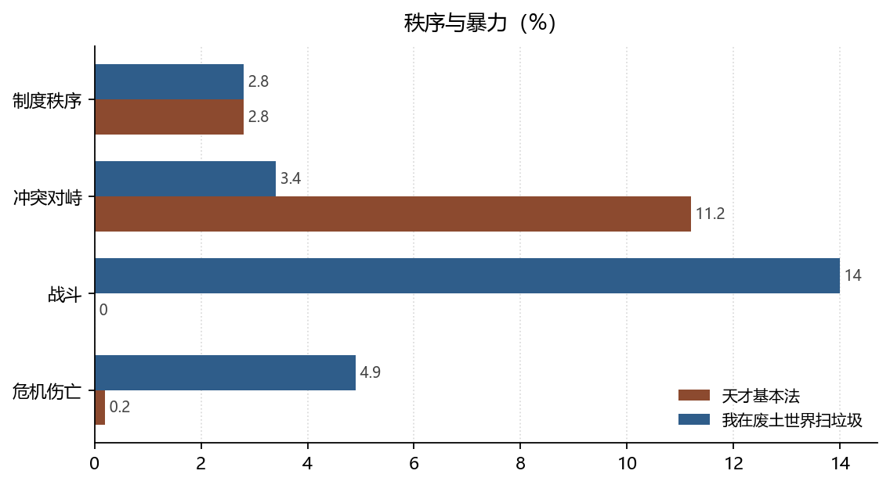

# 规则的两种效力：有裁判的秩序与例外状态

**Two Kinds of Legal Efficacy: Adjudicated Order and the State of Exception**

*拆书项目组（Computational Reading of Two Novels）*

**摘要：**两书「制度秩序」事件占比完全相同（均为 2.8%），但性质相反：天才基本法的秩序由可申诉的规则维持（战斗 0 件、危机伤亡 2 件），我在废土世界扫垃圾的秩序由例外状态维持（战斗 363 件、危机伤亡 128 件、支配关系 48 条）。本文借科弗「暴力与言说」的论题说明：法的效力不在条文，而在它能否把暴力收进程序。

**Abstract:** Institutional-order events share the same share (2.8%) in both novels, yet mean opposite things: one order is appealable (zero battles), the other rests on exception (363 battles, 128 casualties). Following Cover, we argue that law's efficacy lies in whether it can channel violence into procedure.

**关键词：**法社会学；程序正义；例外状态；暴力与法；双文本对照

**Keywords:** sociology of law; procedural justice; state of exception; violence and law; comparative reading

---

## 1. 引言

科弗（Cover, 1986）有一个著名的判断：法律解释的行为本身就包含暴力，因为法的意义最终由「谁被强制」来兑现。这个判断在两本小说里得到了两种截然不同的演示——一本把暴力彻底移出叙事（战斗 0 件），一本让暴力成为秩序的日常（战斗 363 件）。本文比较这两种「法的效力」。

## 2. 数据与方法

### 2.1 语料

天才 833 事件 / 482 关系；废土 2591 事件 / 1606 关系。事件与关系使用同一套基类，便于对照。

### 2.2 指标

- **程序密度**：制度秩序事件数（考试规则、评审、处分、规章）；
- **暴力水平**：战斗与危机伤亡事件数；
- **强制关系**：支配、上下级、敌对三类关系条数。

### 2.3 边界

「制度秩序」是归约标签，可能同时包含校规、组织纪律、据点公约。本文用它衡量**密度**，性质判定依赖具体事件阅读。另需说明：关系条数含跨章重复，仅作量级参考。

*数据来源：本项目知识图谱现算；口径见 §2。*

## 3. 分析与发现

### 3.1 相同的密度，相反的效力

**结论**：天才制度秩序 23 件（2.8%），废土 72 件（2.8%），占比相同；但天才战斗 0 件，废土 363 件（14%）。

> 可信度：高 ｜ 性质：实测 ｜ 证据：`events[].type_base` 计数，分母 833 / 2591 ｜ 来源：`events.json`

相同的百分比掩盖了完全不同的东西。天才的制度是**可援引**的：学生可以质疑评分、可以举报不公、可以要求重考，规则在冲突中被反复调用，所以被大量叙述。废土的制度是**可执行的**：据点准入、物资分配、队伍纪律，规则不需要被援引，只需要被服从。科弗的论题在这里分化成两支——前者靠言说维持，后者靠强制维持。

### 3.2 暴力是否被程序吸收

**结论**：天才危机伤亡 2 件（0.2%），废土 128 件（4.9%）；敌方关系天才 21 条，废土 128 条；支配关系天才 0 条，废土 48 条。

> 可信度：高 ｜ 性质：实测 ｜ 证据：`events[].type_base`、`relations[].rel_base` ｜ 来源：`events.json` / `relations.json`

天才把暴力吸收进了程序：冲突密度不低（11.2%），但后果极轻（0.2%）。这不是因为世界和平，而是因为**暴力被移交给了裁判**——扣分、取消资格、记过，都是暴力的替代物。废土没有这个移交机制，冲突直接兑现为伤亡。埃维克与西尔贝（Ewick & Silbey, 1995）所说的「霸权故事」在这里显出功能：天才反复讲述「规则会给你公道」，这个故事本身就是秩序的维持装置。

### 3.3 例外状态的生产

**结论**：废土撤离救援 31 件（1.2%）、危机伤亡 4.9%，而天才撤离救援 0 件。

> 可信度：中 ｜ 性质：推断（类型归约对「救援」的判定依赖事件描述）｜ 证据：`events[].type_base` ｜ 来源：`events.json`

「撤离救援」是一个只在废土出现的类目。它的存在意味着：常态秩序会周期性失效，需要专门的叙事装置来处理失效。这正是例外状态的经验形态——规则暂停，权力临时集中，事后无人追责。天才没有这个类目，因为它的秩序从不失效，至少不被写成失效。

## 4. 讨论

两种法想象的代价同样互补。可申诉的秩序需要大量程序成本（考试、评审、复核），并且只能在资源相对充裕的世界里维持；例外状态的秩序成本低、响应快，但把每个人置于潜在的可支配位置。奥斯特罗姆（Ostrom, 1990）关于自治规则的研究提示第三条路：规则由参与者共同制定。两本书都没有走这条路——天才的规则由学校制定，废土的规则由据点制定。

边界在于：本文的「法」是广义的社会规则，不是国家法。两书都没有明确的法律机构，因此结论应理解为「秩序技术」的比较，而非法理学判断。

## 5. 结论

天才基本法展示了一种把暴力收进程序的秩序，我在废土世界扫垃圾展示了一种以例外为常态的秩序。两者都有效，但效力的来源相反：**一个来自「你可以申诉」，一个来自「你不能申诉」。**

## 参考文献

- Cover, R. M. (1986). Violence and the Word. *The Yale Law Journal*, *95*(8), 1601. https://doi.org/10.2307/796468
- Ewick, P., & Silbey, S. S. (1995). Subversive Stories and Hegemonic Tales: Toward a Sociology of Narrative. *Law &amp; Society Review*, *29*(2), 197–226. https://doi.org/10.2307/3054010
- Ostrom, E. (1990). *Governing the Commons*. Cambridge University Press. https://doi.org/10.1017/cbo9780511807763

> 文献核验：以上 3 条均由 `src/verify_refs.py` 逐条检索 Crossref，命中类型、年份、作者与标题相似度四道闸后才写入；DOI 可直接打开原记录。少数专著在 Crossref 的注册题名省略了副标题，以注册记录为准。
