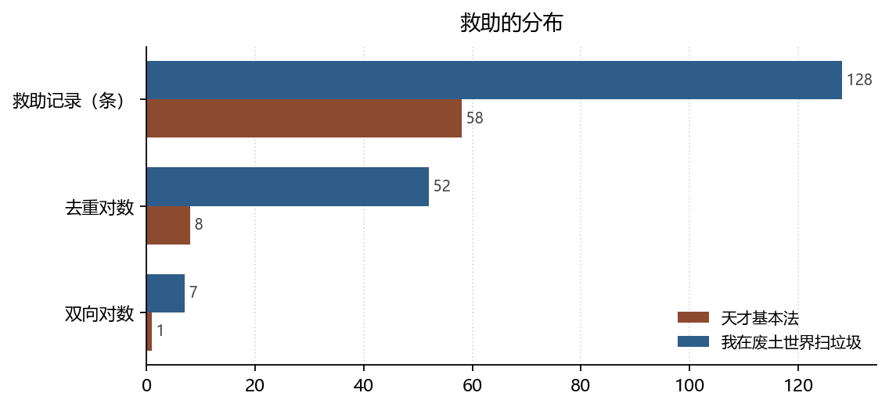

# 救助的分布：关怀伦理与配给伦理

**The Distribution of Rescue: Ethics of Care versus Ethics of Rationing**

*拆书项目组（Computational Reading of Two Novels）*

**摘要：**天才基本法的救助关系 8 条去重后仅 8 个有向对，双向 1 对；我在废土世界扫垃圾 52 条去重后 52 对，双向 7 对。前者是少数人对一个人的长期保护，后者是分散在组织内的互助网络。本文用关怀伦理与公地治理两套框架说明：两种伦理都成立，但一个是关系性的，一个是制度性的。

**Abstract:** Rescue relations collapse to only 8 directed pairs in Tiancai Jibenfa (1 mutual) versus 52 pairs in the wasteland novel (7 mutual). The former is long-term protection by a few; the latter is a distributed mutual-aid network. Care ethics and commons governance explain the two regimes.

**关键词：**关怀伦理；救助关系；资源分配；互惠；双文本对照

**Keywords:** ethics of care; rescue relations; resource allocation; reciprocity; comparative reading

---

## 1. 引言

伦理学的经验入口通常很难找：小说里的人都在做选择，但「选择」很少被标注。救助关系提供了一个可计数的替代物——谁救谁、救了几次、是否双向。这些记录不能告诉我们人物「为什么」救，但能告诉我们**救助在社会结构里如何分布**。

## 2. 数据与方法

### 2.1 语料

天才 482 条关系记录、140 位人物；废土 1606 条、379 位。救助关系取 `relations[].rel_base == "救助"`，按有向对去重后统计。

### 2.2 指标

- **救助对数**：去重后的有向对数量；
- **双向比例**：互为施救者的对数，衡量互惠程度；
- **伤亡暴露**：危机伤亡事件占比，衡量「需要被救」的频率。

### 2.3 边界

关系条数受跨章重复影响，因此同时给出去重值与原始值。救助的判定依赖事件与关系描述中的动词，隐含的照护（做饭、陪护、垫钱）没有计入，这会使「关怀」被系统性低估。

*数据来源：本项目知识图谱现算；口径见 §2。*

## 3. 分析与发现

### 3.1 集中保护与分散互助

**结论**：天才救助 58 条记录 → 8 个有向对（平均每对约 7 条），双向 1 对；废土 128 条 → 52 对（平均每对约 2–3 条），双向 7 对。

> 可信度：高 ｜ 性质：实测 ｜ 证据：`relations[].rel_base` 去重 ｜ 来源：`relations.json`

天才有 58 条救助记录却只涉及 8 组关系——平均每组被记录 7 次以上。这说明救助是**少数关系的反复书写**：同一个人反复被同几个人救。废土的 128 条分散在 52 个对上，平均每组 2–3 次，是**多点低强度的互助**。前者像家庭，后者像制度。

### 3.2 互惠的两种形态

**结论**：天才双向救助 1 对，废土 7 对（占各自对数的 7/52）。

> 可信度：中 ｜ 性质：实测（分母小，比率不稳）｜ 证据：同 3.1 ｜ 来源：`relations.json`

天才的双向救助极少，关怀是**单向的**：长辈护晚辈、老师护学生，受助者很少有机会回报。这与赫尔德（Held, 2005）描述的关怀伦理高度吻合——关怀的价值不在于对等交换，而在于对具体他者的持续回应。废土的双向比例更高，因为组织内的互助必须可预期：今天我背你回来，明天你替我挡一次。这是公地治理的逻辑（Ostrom, 1990）：规则之所以被遵守，是因为每个人都可能轮到需要它。

### 3.3 需要被救的频率

**结论**：天才危机伤亡 2 件（0.2%），废土 128 件（4.9%）。

> 可信度：高 ｜ 性质：实测 ｜ 证据：`events[].type_base` ｜ 来源：`events.json`

废土的救助对数是天才的六倍多，但伤亡事件是六十倍。**需求增长远快于供给增长**——这是废土伦理困境的量化形态：互助网络存在，但不够用。天才的伤亡几乎为零，所以它的关怀可以从容、可以长期、可以不求回报。赫尔德强调关怀需要条件，这个条件在两书中表现为伤亡率。

## 4. 讨论

把两组数字并置，会得到一个不舒服的结论：**关怀伦理的可行性依赖于低伤亡环境**。当伤亡率上升两个数量级，单向的、长期的、不计回报的关怀就难以维持，取而代之的是可计算的互惠。这不是说废土的人更自私，而是说那里的伦理形式被生存条件重塑了。

边界在于：本文只统计「救助」这一种伦理行为，没有覆盖欺骗、背叛、牺牲等负向或高风险行为。完整的伦理图景需要把这些也纳入，而那需要更细的事件标注。

## 5. 结论

天才基本法的伦理是关怀的：少数人对一个人长期负责，不要求回报。我在废土世界扫垃圾的伦理是配给的：互助被组织化、被计价、被期待回报。两种伦理都能成立，但它们各自需要一个世界来支撑——**一个允许慢慢来的世界，一个不允许的世界。**

## 参考文献

- Held, V. (2005). *The Ethics of Care*. Oxford University PressNew York. https://doi.org/10.1093/0195180992.001.0001
- Ostrom, E. (1990). *Governing the Commons*. Cambridge University Press. https://doi.org/10.1017/cbo9780511807763

> 文献核验：以上 2 条均由 `src/verify_refs.py` 逐条检索 Crossref，命中类型、年份、作者与标题相似度四道闸后才写入；DOI 可直接打开原记录。少数专著在 Crossref 的注册题名省略了副标题，以注册记录为准。
