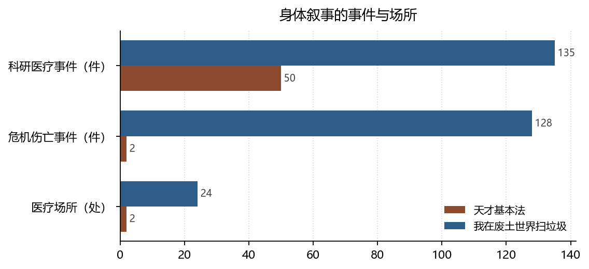

# 疾病作为情节装置：两种身体叙事

**Illness as Plot Device: Two Narratives of the Body**

*拆书项目组（Computational Reading of Two Novels）*

**摘要：**天才基本法把疾病写成记忆问题：事件名中「阿尔茨海默」14 次、「病」13 次，但医疗场所只有 2 处。我在废土世界扫垃圾把身体写成可改造、可污染的对象：「污染」141 次、「尸体」28 次，医疗场所 24 处。本文用比里的「传记性断裂」与哈拉威的赛博格说明：一种身体是被时间侵蚀的，一种身体是被技术改造的。

**Abstract:** Illness in Tiancai Jibenfa is a problem of memory (14 mentions of Alzheimer's, only 2 medical sites), whereas the wasteland novel treats the body as modifiable and contaminable (141 pollution, 28 corpse mentions, 24 medical sites). We read the two through biographical disruption and cyborg theory.

**关键词：**医学人文；疾病叙事；身体；照护；双文本对照

**Keywords:** medical humanities; illness narrative; the body; care; comparative reading

---

## 1. 引言

医学人文的核心问题是：疾病如何改变一个人对自己的叙述。比里（Bury, 1982）把慢性病的影响概括为「传记性断裂」——原有的生活叙事被打断，人必须重写自己。两本小说都写了身体，但写法相反：一本写身体如何被时间侵蚀，一本写身体如何被技术改造。

## 2. 数据与方法

### 2.1 语料

天才 833 事件 / 256 地点；废土 2591 事件 / 1037 地点。医疗相关指标取自事件基类「科研医疗」「危机伤亡」与地点基类「医疗场所」。

### 2.2 关键词口径

只统计**事件名**中的关键词出现次数，不读正文。词表：天才「阿尔茨海默」「病」；废土「污染」「尸体」。这是下限估计——正文里的病症描述未计入。

### 2.3 边界

「科研医疗」既包含治疗也包含实验，两类在伦理上完全不同，本文不做拆分。医疗场所的数量受地点抽取粒度影响（家中的病榻可能未被登记为医疗场所）。

*数据来源：本项目知识图谱现算；口径见 §2。*

## 3. 分析与发现

### 3.1 疾病在事件里，不在医院里

**结论**：天才科研医疗 50 件（6%），医疗场所仅 2 处（0.8%）；事件名含「阿尔茨海默」14 次、含「病」13 次。

> 可信度：高 ｜ 性质：实测（关键词口径）｜ 证据：`events[].type_base`、`events[].name`、`locations[].type_base` ｜ 来源：`events.json` / `locations.json`

疾病在这本书里几乎不发生在医院。它发生在家里、在记忆里、在一个人忽然认不出女儿的瞬间。医疗场所只有 2 处，而「阿尔茨海默」在事件名里出现 14 次——**病是被叙述的，不是被治疗的**。这与比里的观察一致：慢性病对当事人的意义，主要不在临床，而在日常秩序的瓦解。

### 3.2 身体作为可改造对象

**结论**：废土科研医疗 135 件（5.2%）、危机伤亡 128 件（4.9%）、医疗场所 24 处；事件名含「污染」141 次、含「尸体」28 次。

> 可信度：高 ｜ 性质：实测（关键词口径）｜ 证据：同 3.1 ｜ 来源：`events.json` / `locations.json`

废土的身体是**边界模糊**的：污染会进入身体，改造会替换器官，尸体是需要处理的对象。「尸体」28 次的出现频率说明死亡在这里是常态化的物质，而不是事件。哈拉威（Haraway, 1987）的赛博格宣言讨论的正是这种边界崩塌——人与机器、人与动物、人与污染之间不再有清晰分界。废土几乎是把这篇宣言写成了世界观。

### 3.3 照护的两种组织方式

**结论**：天才危机伤亡 2 件（0.2%），废土 128 件（4.9%）；天才救助关系去重 8 对，废土 52 对。

> 可信度：高 ｜ 性质：实测 ｜ 证据：`events[].type_base`、`relations[].rel_base` 去重 ｜ 来源：`events.json` / `relations.json`

照护在天才里是长期的、少数人对一个人的（8 对关系承担了全部救助记录）；在废土里是短期的、多点分布的（52 对关系）。赫尔德（Held, 2005）指出关怀伦理要求对具体他者的持续回应，这种持续性在天才是可能的，因为伤亡率极低；在废土，照护必须被制度化才能覆盖需求。

## 4. 讨论

两种身体叙事的政治含义不同。天才的身体是**不可替换**的：记忆一旦流失就无法恢复，因此照护的意义在于陪伴而非修复。废土的身体是**可替换**的：器官、义体、意识都能被改造，因此照护的意义转向维护与升级。前者接近医学人文的传统议题（尊严、叙事、临终），后者接近生物政治的新议题（可改造性、污染、去人性化）。

边界在于：本文的关键词只覆盖事件名，正文中的病症描写、身体感受、医疗场景对话都没有进入统计。这些恰恰是医学人文最看重的质地，量化方法在这里只能提供骨架。

## 5. 结论

天才基本法写的是被时间侵蚀的身体，我在废土世界扫垃圾写的是被技术改造的身体。前者把疾病写成记忆的丧失，后者把疾病写成边界的溃散。两种写法都指向同一个问题：**当身体不再可靠，人靠什么确认自己还是自己。**

## 参考文献

- Bury, M. (1982). Chronic illness as biographical disruption. *Sociology of Health &amp; Illness*, *4*(2), 167–182. https://doi.org/10.1111/1467-9566.ep11339939
- Haraway, D. (1987). A manifesto for Cyborgs: Science, technology, and socialist feminism in the 1980s. *Australian Feminist Studies*, *2*(4), 1–42. https://doi.org/10.1080/08164649.1987.9961538
- Held, V. (2005). *The Ethics of Care*. Oxford University PressNew York. https://doi.org/10.1093/0195180992.001.0001

> 文献核验：以上 3 条均由 `src/verify_refs.py` 逐条检索 Crossref，命中类型、年份、作者与标题相似度四道闸后才写入；DOI 可直接打开原记录。少数专著在 Crossref 的注册题名省略了副标题，以注册记录为准。
